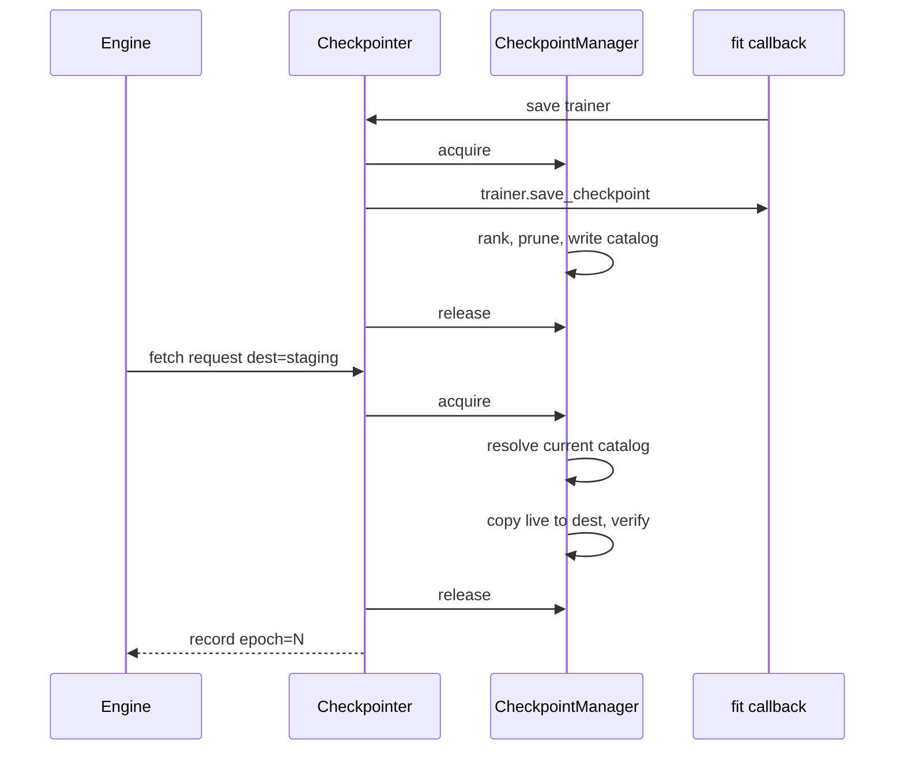

# Checkpoint protocol

We own the directory. Lightning `ModelCheckpoint` is **not** registered. It assumes sole ownership of `dirpath`. A lock or a concurrent copy can make its prune/save fail and crash fit.

Lightning is only the serializer: `trainer.save_checkpoint(path)`. Top-k, `save_last`, prune, catalog, lock, snapshot are ours. Lift ranking/prune rules from `ModelCheckpoint`; do not subclass it.

Trainer: `enable_checkpointing=False`. EarlyStopping may still be a Lightning callback. It does not touch this directory.

## 1. Input

| | |
|---|---|
| Expected | Project protocol knobs on `CheckpointManager` (`lock_timeout_seconds`). Run bind: `run_dir`, `save_top_k`, `save_last`, `monitor`, `max_epochs`. Save: `trainer.current_epoch` and `callback_metrics[monitor.key]`. Fetch: a `CheckpointRequest`. |
| Comes from | Default: `checkpoint.json` (`lock_timeout_seconds`) + recipe `checkpoint_config` + `experiment.monitor`. Core bind happens after experiment build. |
| Conditions | `save_top_k >= -1`. `monitor.mode` is `min` or `max`. `run_dir` absolute. |

**Potential issues**

- Registering `ModelCheckpoint`. Fit then fights inspect for the directory.
- Parsing identity from filenames. Identity is the catalog `epoch`.
- `lookup` returning a live path. Fetch copies under the lock.
- Resolve then copy as two lock sections. Prune wins in between. `fetch` is one critical section.
- Holding the lock during `inspect_fn`. That callable is GPU work. Lock is only resolve+copy.
- Rank as a durable identity. Rank is current-time. The record is still an epoch.

## 2. Processing

### Layout

```
run_dir/checkpoints/
  catalog.lock/     # exclusive mkdir lock
  catalog.json
  live/<id>.ckpt
```

Filename is opaque. Do not parse names.

### Catalog

```json
{
  "monitor": {"key": "val/loss", "mode": "min"},
  "policy": {"save_top_k": 1, "save_last": false},
  "fit": {"status": "running", "latest_epoch": 7, "max_epochs": 50},
  "current": {
    "files": [
      {"epoch": 7, "id": "a1b2c3", "path": "live/a1b2c3.ckpt",
       "score": 0.041, "rank": 1, "sha256": "...", "bytes": 123}
    ],
    "last": {"epoch": 7, "id": "a1b2c3"}
  },
  "history": {
    "7": {"id": "a1b2c3", "score": 0.041, "rank_then": 1,
          "sha256": "...", "retained": true}
  }
}
```

`current.files` are retained live files; `rank` is **now**. `history[epoch]` is metadata; `retained=false` after prune; does not resurrect weights. `fit` is [fit_state.md](../core/fit_state.md).

### Lock

One exclusive mkdir lock: `checkpoints/catalog.lock`.

| Critical section | Holds lock | Must not |
|---|---|---|
| A. save + rank + prune + catalog write | yes | inspect snapshot |
| B. resolve + copy live → dest + checksum | yes | save/prune |
| C. `inspect_fn`, vendor publish, `fit_state` JSON read | no | — |

`catalog.json` is tmp + replace, so `fit_state()` may read without the lock. **Fetch may not.**

If B is copying a large file, A waits at the next validation end. Fit must not crash. That is the trade.

### Algorithm A — save

Callback `on_validation_end`, skip sanity checking. Then `checkpointer.save(trainer)`:

1. `epoch = trainer.current_epoch`. `score` from `callback_metrics[monitor.key]` (missing → fail closed, no save).
2. Acquire exclusive lock.
3. `id = new_id()`; `path = live/{id}.ckpt`.
4. `trainer.save_checkpoint(path)`.
5. `sha256, bytes` of that file.
6. Rank **retained ∪ {new}** by score (`mode` min/max). Assign `rank` 1..n on the top-k keep set (`-1` keeps all).
7. If `save_last`, `current.last` points at this epoch’s id. Keep that file even if it is not in top-k. No second copy if it already is.
8. Delete live files whose ids are not in (top-k ∪ last).
9. `history[epoch] = {id, score, rank_then, sha256, retained}`. Dropped ids: `retained=false`.
10. `current.files = top-k`; `fit.latest_epoch = epoch`; `fit.status = running`.
11. Atomic write `catalog.json`.
12. Release lock.
13. On exception after step 4: delete `path` if the catalog was not committed; always release.

`mark_finished()`: acquire, `fit.status = finished`, write catalog, release.

### Algorithm B — fetch

`checkpointer.fetch(request, dest=staging)` is one call:

1. Acquire exclusive lock.
2. Read catalog. Resolve against **current** (except `epoch=N`, which requires a current retained row):
   - `epoch=N` → current row with that epoch. History `retained=false` → fail closed.
   - `rank=K` → current row with `rank==K` **now**. Never history.
   - `value=S` → current row with that score. Never history.
   - `last` → `current.last`.
3. No row or live file missing → release, `CheckpointLookupError`.
4. Copy `live/{id}.ckpt` → `dest/{id}.ckpt`.
5. Verify sha256 and bytes. Mismatch → delete dest copy, release, error.
6. Release lock.
7. Return `CheckpointRecord(epoch, rank_at_query, score, path=dest/...)`.



## 3. Output

| | |
|---|---|
| Expected | `as_callback()` for fit. `fetch` for inspect. `fit_state()` from catalog. Catalog on disk. |
| Consumers | `ExpEngine.train` / `inspect`. Never Lightning `ModelCheckpoint`. |
