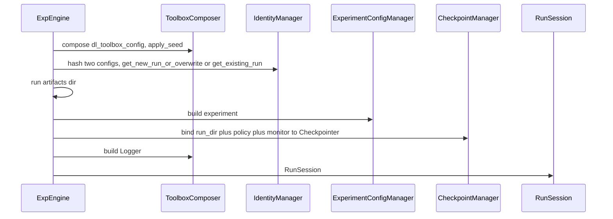

# ExpEngine

Core orchestrator. Receives managers. Does not walk a project tree.

## 1. Input

| | |
|---|---|
| Expected | `IdentityManager`, `LoggingManager`, `CheckpointManager` (project protocol), `ExperimentConfigManager`, `EnginePaths`, `compose_toolbox` (callable that builds a `ToolboxComposer` from `dl_toolbox_config`), `tracking_backend`. A run recipe (path or mapping). `inspect` also takes `inspect_fn`. |
| Comes from | Default engine constructs managers from scaffolded JSON and passes them here. Tests inject fakes. |
| Conditions | Recipe has the three keys. Toolbox schema is the composer’s problem. Name is not hashed. |

**Potential issues**

- Discovering `identity.json` inside the core. That is default layout.
- Holding fit loop objects on the engine instance for inspect. Inspect is another process. State is the catalog.
- Folding get_new_run_or_overwrite and get_existing_run into one boolean flag at the public API. They stay two methods. `train` calls `get_new_run_or_overwrite`. `inspect` calls `get_existing_run`. The decision tree is the contract on those methods.
- `force=True` stealing `hash_taken` or wiping `both_match`. Force only overwrites `name_taken`. See [get_new_run_or_overwrite.md](../identity/get_new_run_or_overwrite.md).
- Sharing the fit process writer on inspect. Inspect calls `Logger.setup(stream="inspect")` in its own process.
- Putting inspect knobs in the training recipe (they would enter the hash).

## 2. Processing



Order that must not flip: compose toolbox → apply seed → identity get_new_run_or_overwrite/get_existing_run + mkdir run artifacts → `ExperimentConfigManager.build` → bind checkpointer with `experiment.monitor` → logger → session.

`reclaim_name` is identity `release_name` plus run-artifacts `rmtree`. Logger stores are left alone.

`get_new_run_or_overwrite` / `get_existing_run` wrap identity pair write + run-artifacts mkdir in a `run_identities_root` lock. Two JSON files plus mkdir are not one filesystem transaction. The decision tree is the contract on those methods.

```python
engine.train(recipe)     # get_new_run_or_overwrite + fit; Logger.setup; enable_checkpointing=False
engine.inspect(recipe, inspection_recipe, inspect_fn=...)
engine.fit_state(session)
```

`train` `finally` calls `checkpointer.mark_finished()`. Inspect is Algorithm B in [inspect.md](../inspect/inspect.md).

## 3. Output

| | |
|---|---|
| Expected | `RunSession`. `train` returns the Lightning `Trainer`. `inspect` returns the exclusive epoch folder. `fit_state` returns catalog-derived status. |
| Consumers | Project scripts. Not a third assembler in the script. |
