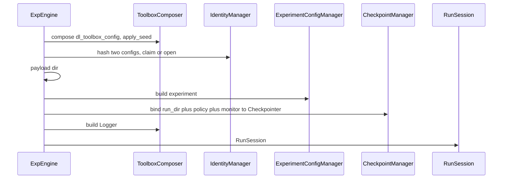

# ExpEngine

Core orchestrator. Receives managers. Does not walk a project tree.

## 1. Input

| | |
|---|---|
| Expected | `IdentityManager`, `LoggingManager`, `CheckpointManager` (project protocol), `ExperimentConfigManager`, `EnginePaths`, `compose_toolbox` (callable that builds a `ToolboxComposer` from `dl_toolbox_config`), optional `InspectionManager`, `tracking_backend`. A run recipe (path or mapping). |
| Comes from | Default engine constructs managers from scaffolded JSON and passes them here. Tests inject fakes. |
| Conditions | Recipe has the three keys. Toolbox schema is the composer’s problem. Name is not hashed. |

**Potential issues**

- Discovering `identity.json` inside the core. That is default layout.
- Holding fit loop objects on the engine instance for inspect. Inspect is another process. State is the catalog.
- Folding claim and open into one boolean flag at the public API. `claim` / `open` stay two methods. `train` calls `claim`. `inspect` calls `open`.
- `force=True` stealing `hash_taken`. Force only reclaims a **name**.
- Opening a live vendor run on inspect. `Logger.setup` is fit-only.
- Putting inspect knobs in the training recipe (they would enter the hash).

## 2. Processing



Order that must not flip: compose toolbox → apply seed → identity claim/open + mkdir payload → `ExperimentConfigManager.build` → bind checkpointer with `experiment.monitor` → logger → session.

`reclaim_name` is identity `release_name` plus payload `rmtree`. Logger stores are left alone.

Claim/open wrap identity pair write + payload mkdir in a records-dir lock. Two JSON files plus mkdir are not one filesystem transaction.

```python
engine.train(recipe)     # claim + fit; Logger.setup; enable_checkpointing=False
engine.inspect(recipe, inspection_recipe)
engine.fit_state(session)
```

`train` `finally` calls `checkpointer.mark_finished()`. Inspect is Algorithm B in [inspect.md](../inspect/inspect.md).

## 3. Output

| | |
|---|---|
| Expected | `RunSession`. `train` returns the Lightning `Trainer`. `inspect` returns the exclusive epoch folder. `fit_state` returns catalog-derived status. |
| Consumers | Project scripts. Not a third assembler in the script. |
