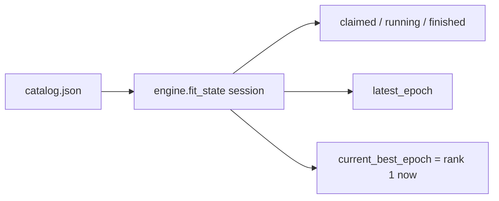

# Fit state

How the engine “internalizes” training: it **reads the catalog**. Nothing is remembered on the `ExpEngine` instance.

## 1. Input

| | |
|---|---|
| Expected | A `RunSession` (payload exists). Catalog may be missing (claimed, no validation yet). |
| Comes from | `checkpointer.fit_state()` → `catalog.json` `fit` block + `current`. |
| Conditions | Atomic JSON read. No lock. |

## 2. Processing

| Disk | Status |
|---|---|
| payload, no catalog | `claimed` |
| `fit.status = running` | `running`; `latest_epoch` is last written epoch |
| `fit.status = finished` | `finished` (`mark_finished` in train `finally`) |

`current_best_epoch` is the epoch of `rank=1` in `current.files` at read time, or absent.

Interrupted (process gone, status still `running`) is not detected in this pass. Callers see `running`.

## 3. Output

A `FitRunState` value: `status`, `latest_epoch`, `current_best_epoch`, `max_epochs`.
