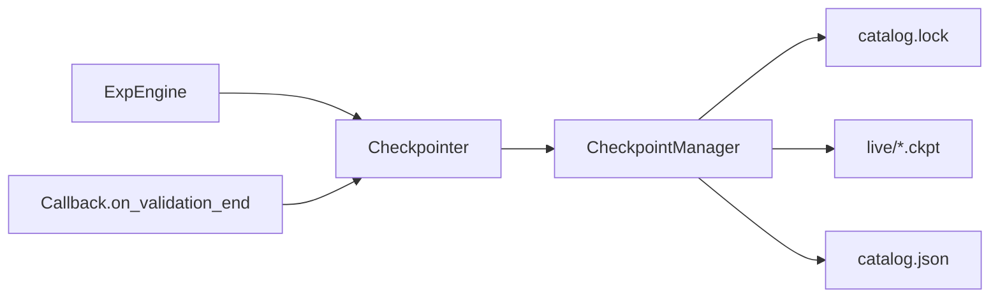

# Roles

What the core talks to. Implementations live in `base` / `dl_engine` (Fold 1). The default engine constructs them (Fold 2).

| Role | Lifetime | Job | Default impl |
|---|---|---|---|
| IdentityManager | project | hash configs; exclusive `(name, hash)`; lookup / claim / release | `HashManager` |
| LoggingManager | project | vendor store; `publish_directory` | TB / W&B / MLflow / placeholder |
| Logger | run | live scalars / artifacts | matching Logger |
| CheckpointManager | project protocol, bound per run | lock, catalog, checksum, prune, snapshot copy | `dl_engine.training.checkpointer` |
| Checkpointer | run façade | `save` / `fetch` / `fit_state` / `as_callback`; talks only to CheckpointManager | same package |
| ExperimentConfigManager | project subclass | JSON → net, loaders, monitor | project writes this |
| ToolboxComposer | one recipe | seed, trainer, ES, logger kwargs, ckpt policy | `DlToolboxConfigManager` |

No manager for trainer / seed / early stopping. Parsers → values. ToolboxComposer is not a store. Inspect is a project `inspect_fn` passed to `engine.inspect`.

## ToolboxComposer

Core does not parse nested toolbox keys. It calls:

- `apply_seed()`
- `seed_config()` / `trainer_config()` / `early_stopping_config()`
- `checkpoint_policy()` → `save_top_k`, `save_last`
- `build_logger()` → `Logger` using the injected `LoggingManager`

`compose_toolbox(payload, *, backend, logging_manager)` is injected. The default callable is `DlToolboxConfigManager`.

## Checkpointer vs CheckpointManager

Engine never calls CheckpointManager. Fit and inspect never share a live path.

The inspect callable loads `record.path` (the snapshot). It never opens `checkpoints/live`.
