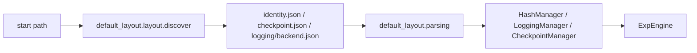

# DefaultExpEngine

Same core. Specifies components from the default tree.

Code: `experiment_management/engine/default`. Layout and parsers: `experiment_management/default_layout` (`layout/` + `parsing/`).

## 1. Input

`project_name`, `start` path, `ExperimentConfigManager`. Walks to `dl_toolbox_project.json`.

## 2. Processing



Two jobs, in `default_layout`:

1. **layout/** — names, discover, scaffold (`setup_project` writes `identity.json`, `checkpoint.json`, `logging/{backend}.json`).
2. **parsing/** — those files → constructor fields. Does not construct managers.

`DefaultExpEngine` constructs Fold-1 objects and calls `ExpEngine.__init__`.

```python
from dl_toolbox.experiment_management.engine.default.engine import DefaultExpEngine

DefaultExpEngine(
    project_name,
    start=Path(__file__),
    experiment=MnistVitExperimentConfigManager(),
)
```

The project does not subclass this class to teach it a loss.

`checkpoint.json`:

```json
{ "lock_timeout_seconds": 600.0 }
```

## 3. Output

An `ExpEngine` ready for `train` / `inspect`.
