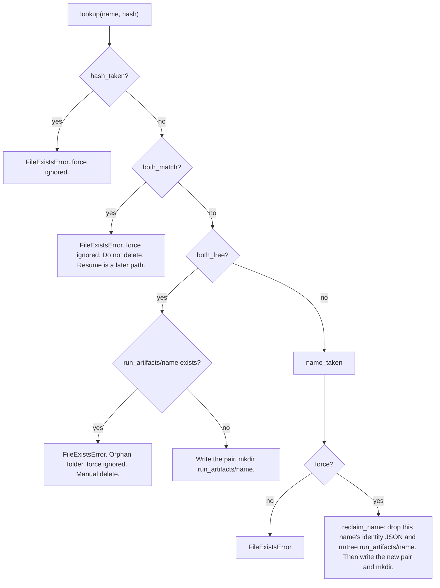

# get_new_run_or_overwrite — decision tree (contract)

Locked contract. Implementation: `ExpEngine.get_new_run_or_overwrite` / `_create_or_overwrite_run`. Changing the branches changes this document.

`train()` is the only caller. `inspect()` uses `get_existing_run`, which is a different tree. A later **resume** path will also require an existing `(name, hash)` pair, like inspect. Resume is **not** a branch of this tree.

## What is looked up

The recipe file is always parsed. Identity is not “does that file exist”.

Identity is the pair:

```
(human_readable_name, hash({dl_toolbox_config, experiment_config}))
```

The name is a label. It is not hashed. Lookup of that pair has four states:

| State | Meaning |
|---|---|
| `hash_taken` | This **hash** already belongs to a **different** name. |
| `both_match` | This exact `(name, hash)` pair already exists. |
| `both_free` | Neither this name nor this hash is stored. |
| `name_taken` | This **name** exists, with a **different** hash. |

Catalog fit status (`claimed` / `running` / `finished`) is **not** part of this tree. Interrupted vs live is **not** part of this tree.

## Decision tree

Evaluate in this order. Later branches are unreachable once an earlier one matches.



### 1. `hash_taken`

This configuration hash already belongs to another name.

Always `FileExistsError`. `force` does not apply. You cannot steal another run’s configuration.

### 2. `both_match`

This exact run already exists. Nothing in the hashed configs changed.

Always `FileExistsError`. `force` does not apply. Do **not** delete the run. Do **not** start a second fit on the same pair.

During active development, delete identity JSON and `run_artifacts/{name}` **manually** if you need a clean slate.

A later resume path will attach to this pair, the same way inspect does. It will not go through this method.

### 3. `both_free`

Name is free and hash is free.

If `run_artifacts/{name}` already exists: `FileExistsError`. Orphan folder; identity does not own it. `force` does not apply. Manual delete, same as `both_match`.

Else create: write the `(name, hash)` JSON pair under `run_identities_root`, then `mkdir` `run_artifacts/{name}`.

### 4. `name_taken`

This name exists with a **different** hash. This is the only branch where `force` applies.

| `force` | Result |
|---|---|
| `False` | `FileExistsError` |
| `True` | Overwrite **this name**: `release_name` + `rmtree` `run_artifacts/{name}`, then create as in branch 3. Logger stores (TensorBoard, MLflow, …) are not touched. |

`force=True` never overwrites a `both_match` run, never steals a `hash_taken` hash, and never deletes an orphan artifacts folder.

## Out of this tree

| Path | Role |
|---|---|
| `get_existing_run` | Inspect. Requires `both_match` and `run_artifacts/{name}` on disk. Creates nothing. |
| Resume (later) | Attach to an existing `(name, hash)` pair. Same *kind* of gate as inspect, not a `force` branch here. |
| Catalog / liveness | Not consulted. Finished, running, and interrupted are indistinguishable to this method. |

## Lock and disk

The identity write and the artifacts `mkdir` run under a `run_identities_root` lock (`identity.lock`). Two JSON files plus `mkdir` are not one filesystem transaction.

`reclaim_name` is identity `release_name` plus artifacts `rmtree`. It is only used by branch 4 (`name_taken` + `force=True`).
