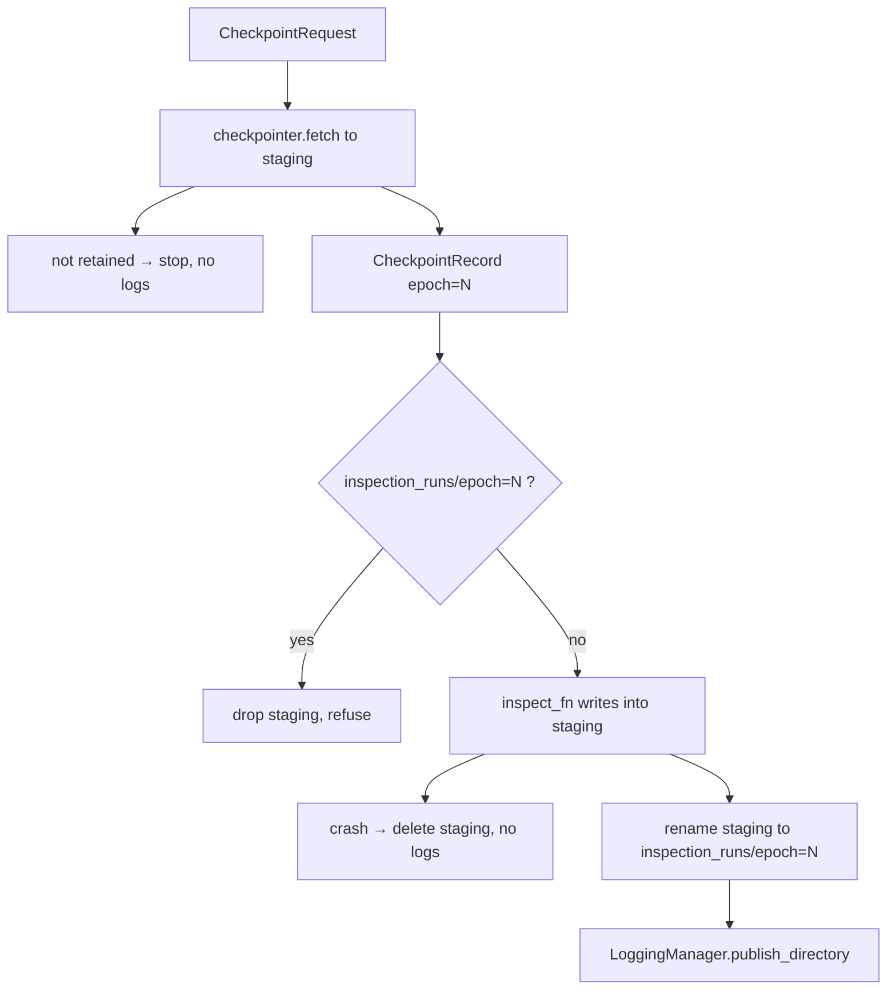

# Inspect

One invocation, one epoch folder. Same `RunSession` as fit. Different writer rules.

Request → Engine → Checkpointer → CheckpointManager (Algorithm B). The engine runs the project callable on the **staging copy**, then commits `inspection_runs/epoch=N`, then publishes.

## 1. Input

| | |
|---|---|
| Expected | An already claimed run (open, not claim). An inspection recipe that is **not** in the training recipe. Selector: `epoch=N`, `rank=K`, `value=S`, or `last`. An `inspect_fn` from `InspectionManager` or the caller. |
| Comes from | Sibling inspect script. Signature from `open`. Weights from `checkpointer.fetch`. |
| Conditions | Identity both-match. Payload exists. Fetch must resolve a **retained** file. `inspection_runs/epoch=N` must not already exist. |

**Potential issues**

- Loading `checkpoints/live`. The callable uses `record.path`.
- Two live MLflow writers (`start_run` while fit is open). Publish uses `LoggingManager.publish_directory`.
- Naming the inspect folder by rank. Rank changes. Folder is `epoch=N`.
- Logging inspect artifacts before commit. Crash would publish a partial run. Publish after rename.
- Holding the checkpoint lock during `inspect_fn`.

## 2. Processing



Inspection recipe example (not hashed):

```json
{ "selector": "rank=1" }
```

`rank=1` means best right now. The snapshot is stored under the epoch returned.

Periodic GPU polling stays in the project script. `CheckpointLookupError` / checksum fail → retry next interval.

## 3. Output

| | |
|---|---|
| Expected | `inspection_runs/epoch=N/` with `manifest.json` + artifacts. Same tree published under the vendor dest `inspection/epoch=N`. |
| Consumers | Error analysis. Never fit. |
