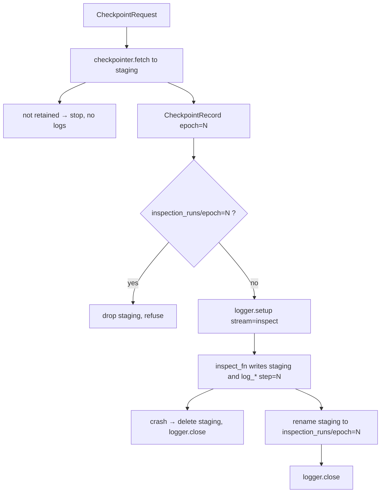

# Inspect

One invocation, one epoch folder. Same `RunSession` as fit. Inspect opens its own Logger stream.

Request → Engine → Checkpointer → CheckpointManager (Algorithm B). The engine runs the project callable on the **staging copy**, then commits `inspection_runs/epoch=N`. `InspectFn` logs through `session.logger` (`log_image` / `log_table` / `log_text`, `step=epoch`).

## 1. Input

| | |
|---|---|
| Expected | An already existing run (`get_existing_run`, not `get_new_run_or_overwrite`). An inspection recipe that is **not** in the training recipe. Selector: `epoch=N`, `rank=K`, `value=S`, or `last`. A required `inspect_fn` from the caller. |
| Comes from | Sibling inspect script. Signature from `get_existing_run`. Weights from `checkpointer.fetch`. |
| Conditions | Identity both-match. Payload exists. Fetch must resolve a **retained** file. `inspection_runs/epoch=N` must not already exist. |

**Potential issues**

- Loading `checkpoints/live`. The callable uses `record.path`.
- Inspect `Logger.setup(stream="inspect")` sharing the fit process writer. It must be a second process.
- Naming the inspect folder by rank. Rank changes. Folder is `epoch=N`.
- Holding the checkpoint lock during `inspect_fn`.
- Publishing the fetched `.ckpt` through the logger.

## 2. Processing



Inspection recipe example (not hashed):

```json
{ "selector": "rank=1" }
```

`rank=1` means best right now. The snapshot is stored under the epoch returned.

Periodic GPU polling stays in the project script. `CheckpointLookupError` / checksum fail → retry next interval. After each attempt the script reads `engine.fit_state(session)` from the catalog; `status == finished` ends the loop (one last inspect of current `rank=1` happens in that same attempt if the epoch folder does not yet exist). `inspect()` itself is one-shot.

## 3. Output

| | |
|---|---|
| Expected | `inspection_runs/epoch=N/` with `manifest.json` + project files. Logger events at `step=N` on the fit run (TensorBoard overlay or MLflow same `run_id`). |
| Consumers | Error analysis. Never fit. |
