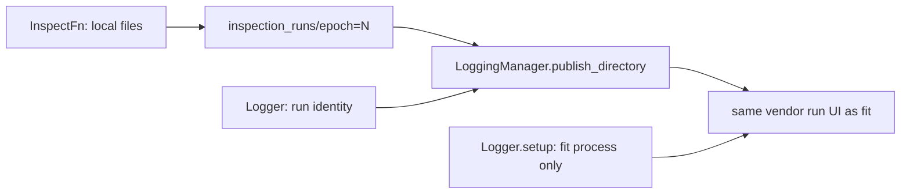

# Inspect → logging (proposal, not locked)

Do not implement until this document is locked. Implementation that lands before a lock will be a backend copy rule with no UI contract — which is the current hole.

The point of fit and inspect running **together** is not that inspect writes PNG files next to checkpoints. It is that the **same vendor UI that shows the fit curve also shows the inspect snapshot for that epoch**. Disk is the shared state. The logger is how a person sees both.

## Roles (existing — do not add a fourth class)

| Who | Lifetime | Inspect-time job | Must not |
|---|---|---|---|
| `InspectFn` | one epoch folder | Write local files into staging (`manifest` is engine; panels/json are the project). | Call `logger.setup` / `log_*` / vendor SDKs. |
| `ExpEngine.inspect` | one invocation | Fetch → exclusive commit `inspection_runs/epoch=N` → then `logging_manager.publish_directory`. | Open a live run. Interpret PNG vs JSON. |
| `Logger` | this run | **Identity only** on the inspect path (`run_name`, and later a persisted vendor `run_id`). Fit uses the same object as a live writer (`setup` / scalars / close). | Inspect must not `setup` / `close` the fit run. |
| `LoggingManager` | project | Vendor store. The **only** inspect→vendor write: `publish_directory`. | A second live writer on the fit event stream. |

`RunSession` already holds both `logger` and `logging_manager`. That is the wiring. `engine.inspect` already calls `publish_directory` after rename. The missing contract is **what publish must mean**.

Periodic looping and **stop when `fit_state.status == finished`** stay in the project script. They are not a logging concern and not an engine `inspect()` concern. `inspect()` is one-shot.

## Current contract is a placement rule, not a UI rule

[logging.md](../logging/logging.md) says:

- filesystem backends copy to `{log_dir}/{run_name}/{dest}`
- MLflow `log_artifacts(run_id)` without `start_run`
- W&B local copy, no `wandb.init`
- `dest` is `inspection/epoch=N`; exclusive if the target exists
- inspect must not `Logger.setup` while fit might be open

That is **where bytes go**. It is not **what a person sees**.

What the MNIST run actually did:

1. Fit opened a SummaryWriter on `storage/tensorboard/mnist_vit_baseline/` and wrote `events.out.tfevents.*`. TensorBoard shows those scalars.
2. Inspect `publish_directory` copied `inspection/epoch=N/{png,json,ckpt}` **next to** that event file.
3. TensorBoard `--logdir` indexes **event files**. Loose PNGs do not appear in the Images tab. Copy succeeded; the joint UI failed.
4. The fetched `.ckpt` was inside staging, so it was copied into the TensorBoard tree as well.

MLflow’s client `log_artifacts` is closer to a UI postcondition (the folder shows on that run). The inspect process still has no fit `run_id` unless it is persisted on disk — today’s inspect `Logger` is a freshly built object, so even MLflow attach is incomplete. W&B without `wandb.init` is the same class of hole as TensorBoard: files on disk, not in the dashboard.

## What “connected” must mean

After `inspection_runs/epoch=N` is committed:

1. A person looking at **this fit run** can find the inspect snapshot without a second experiment identity. TensorBoard’s grouping model may show a **child** sidebar run under the same name; that is allowed. A new top-level run name is not.
2. The snapshot is addressed by **epoch N**, not by rank. Rank moves; the folder name does not.
3. Inspect never opens a second live writer in the directory the fit writer owns.
4. Publish stays exclusive on `dest`. Publish stays **after** rename. Crash before rename → no vendor write.
5. `InspectFn` stays file-only. The manager translates the committed folder into vendor-visible records.
6. The checkpoint snapshot is **not** a logging artifact. It stays on the payload disk (`checkpoints/live` and/or `inspection_runs/epoch=N` if we keep the fetch copy there). Publish sends inspect outputs + `manifest.json`.

## Why inspect cannot use `Logger.setup`

| Backend | Fit owns | Second `setup` from inspect |
|---|---|---|
| TensorBoard | one `SummaryWriter` on `{log_dir}/{run_name}/` | A second writer in that directory races the fit process. |
| MLflow | `start_run` in the train process | Another `start_run` is a **new** run, not an append. |
| W&B | `wandb.init` in train | Another `init` is a second process-run. |

This prohibition in [logging.md](../logging/logging.md) stays.

Open-run state (SummaryWriter, wandb run) belongs on the **Logger**, not the manager. That follow-up is still true. Inspect publish must not depend on the manager holding a live writer.

## Proposed `publish_directory` postcondition

Keep the method. Tighten the postcondition:

**The committed tree is queryable in the vendor UI of this run, without `Logger.setup`.**

Copying files is allowed **in addition** when the backend is a filesystem. Copying files is **not** sufficient when the UI only indexes event streams or cloud artifacts.

| Backend | Fit live writer owns | Inspect publish (proposed) |
|---|---|---|
| TensorBoard | `{log_dir}/{run_name}/` event file | Do **not** write events into that directory. Open a **short-lived** `SummaryWriter` on `{log_dir}/{run_name}/{dest}/`, log images/text with `global_step = epoch`, close it before return. Optional: still copy png/json for humans browsing disk. Never copy `.ckpt`. TensorBoard `--logdir` then shows a child run `run_name/inspection/epoch=N` with an Images tab. |
| MLflow | train process `start_run` | `MlflowClient.log_artifacts(run_id, local_dir, artifact_path=dest)` as today. `run_id` must be **attachable from disk** (inspect did not open the run). |
| W&B | train process `wandb.init` | Either upload to the fit run via API using a persisted run id, or admit W&B inspect is disk-only. Local copy without init is not “connected”. |
| Placeholder | none | copytree of inspect outputs + manifest. |

### Honest TensorBoard limit

Images **on the same scalar chart** at `step=epoch` would require writing into the fit writer’s directory. That is forbidden while fit is live. Safe times for a shared event file: after `logger.close()`, or inspect in-process. Both contradict “together, two processes”.

So the TensorBoard contract is **sibling event streams under the same run name**, not a shared `SummaryWriter`. That is still “connected”: one comparison index, one run family, inspect snapshots next to the fit curve. It is not overlay on the loss plot.

## Second hole: inspect’s `Logger` is not the fit run

`get_existing_run` builds a `Logger` from the recipe’s `run_name`. TensorBoard can key the folder off that name. MLflow/W&B need the vendor run id that `setup` created in the **train** process.

That id is not in `catalog.json` today. Persisting it (payload sidecar, or a logging-owned file under the run artifacts) is a **logging-role** follow-up, not an `InspectFn` follow-up. Until that exists, MLflow/W&B cannot honestly claim “same run”.

## What we will not do

- `InspectFn` calling `session.logger.log_*` (dual source of truth: files and live logs; backend leaks into the project callable).
- Engine calling `logger.setup` on the inspect path.
- A fourth class (`InspectionLogger`, `InspectionManager`).
- Putting inspect knobs in the hashed training recipe.
- Treating copytree as “logged” for TensorBoard.
- Sharing the fit `SummaryWriter` across processes.
- Publishing the fetched checkpoint into the vendor store.

## Decisions to lock (when you say so)

1. `InspectFn` writes files. Engine commits. `LoggingManager.publish_directory` is the only vendor write.
2. Publish postcondition is **UI-queryable on this run**, backend-defined by the table above — not “bytes exist under log_dir”.
3. TensorBoard: child event directory under `dest`, short-lived writer, `step=epoch`, no checkpoint file.
4. Inspect’s `Logger` is identity-only. Vendor run id must be attachable from disk for backends that need it.
5. Periodic stop-on-finished stays in the project script via `engine.fit_state`.
