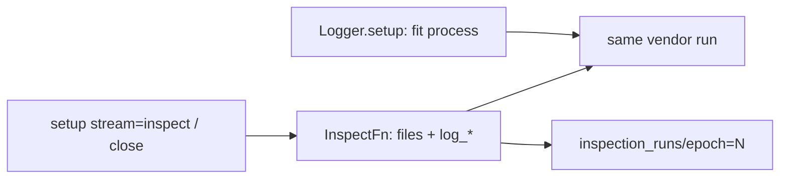

# Inspect → logging

Locked for TensorBoard and MLflow. W&B attach-by-run-id is still open.

The point of fit and inspect running **together** is that the same vendor UI that shows the fit curve also shows the inspect snapshot for that epoch.

## Roles

| Who | Lifetime | Inspect-time job | Must not |
|---|---|---|---|
| `InspectFn` | one epoch folder | Write local files into staging **and** call `session.logger.log_image` / `log_table` / `log_text` with `step=record.epoch`. | Interpret vendor SDKs. Log the fetched `.ckpt`. |
| `ExpEngine.inspect` | one invocation | Fetch → `logger.setup(stream="inspect")` → `inspect_fn` → exclusive commit `inspection_runs/epoch=N` → `logger.close()`. | `publish_directory`. Copy trees into the log dir. |
| `Logger` | this process | Open-run state and every `log_*`. TensorBoard inspect is a second `SummaryWriter` (`filename_suffix=".inspect"`). MLflow inspect is `MlflowClient` + the fit run id. | Share the fit process writer. `start_run` / `end_run` on inspect. |
| `LoggingManager` | project | Store only: `prepare`, `create_writer` / tracking URI / `client`. MLflow also records `{db_parent}/run_ids/{experiment}/{run_name}.json`. | `log_*`. |

## TensorBoard

Fit writer: `{log_dir}/{run_name}/` default suffix.

Inspect writer: same directory, `filename_suffix=".inspect"`. Images at `global_step=epoch`.

`tensorboard_run.py` passes `--reload_multifile=true`. Without it, live scalars freeze when the inspect event file appears.

## MLflow

Fit `setup()`: `create_run`, write the run-id pointer, log through `MlflowClient`. Fit `close()`: `set_terminated`.

Inspect `setup(stream="inspect")`: read the pointer, `get_run`, log through the same client and run id. Images use `key` + `step=epoch`. Inspect `close()` does not terminate the fit run.

`start_run(run_id=)` is forbidden while fit might still be open: it would resume RUNNING and inspect `end_run()` would finish training.

## W&B

`setup(stream="inspect")` prepares the store and does not `wandb.init`. `log_*` on inspect requires an attached run id (not implemented). Disk payload under `inspection_runs/epoch=N` still works.
