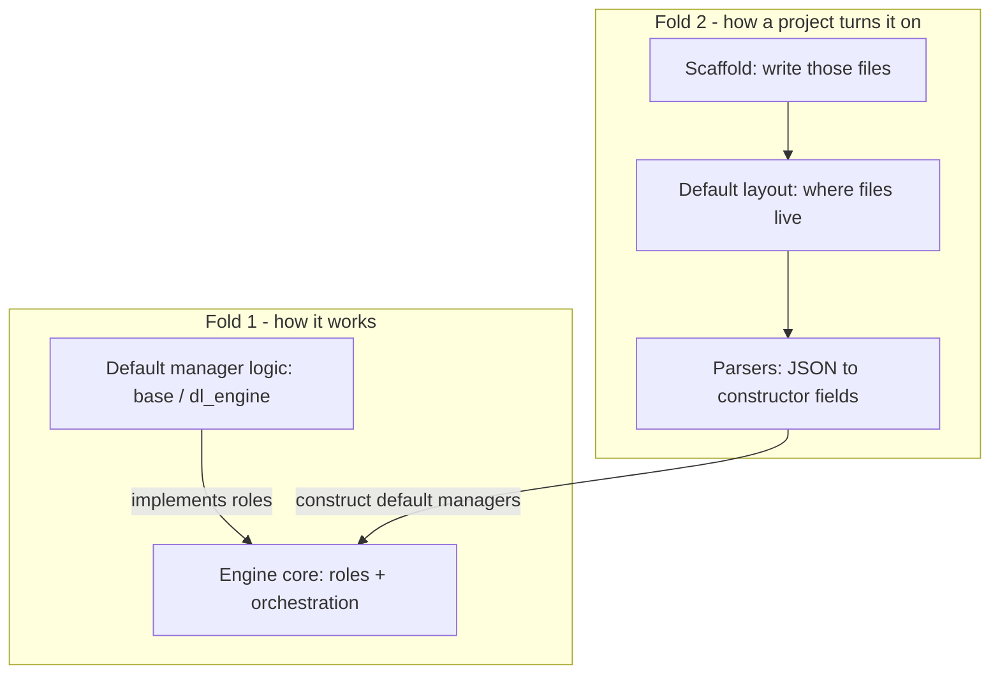
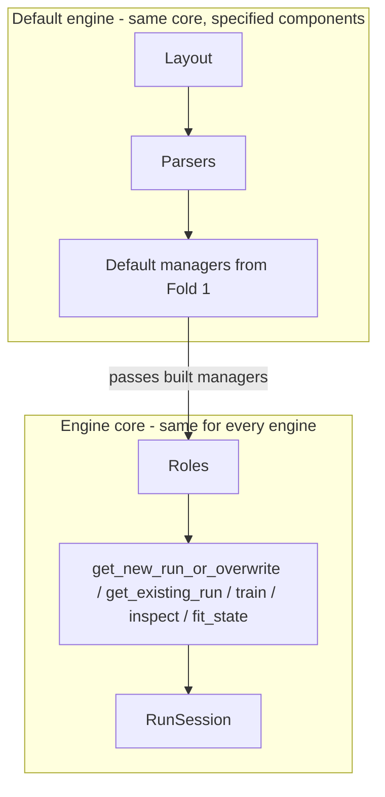

# exp_mng_e

The experiment management engine. Fit, logging, and inspect run together because they share **disk**, not a process and not RAM.

This folder is the contract for the engine. A project subclasses `ExperimentConfigManager`, edits scaffolded JSON, and constructs `DefaultExpEngine`.

Fit and inspect never share a process.

## Two folds of opinion



- **Fold 1** — uniqueness, catalogs, vendor stores, fetch protocol. Lives in `base/` and `dl_engine/`. No project tree. No recipe JSON. `dl_engine` never imports `experiment_management`.
- **Fold 2** — which JSON files exist, where they sit, how they become those objects. Lives in the **default engine**. A project edits scaffolded JSON or subclasses `ExperimentConfigManager`. It does not reimplement catalogs.

## Core vs default



**Core** does not know `identity.json` or `storage/runs`. It receives managers and injected paths. It defines the protocol between roles.

**Default** keeps that core. It only does layout and parsing. Constructor: `ExperimentConfigManager`.

```python
ExpEngine(identity, logging, checkpoint, experiment, paths, compose_toolbox, tracking_backend)

DefaultExpEngine(project_name, start=..., experiment=...)
```

## Epoch vs rank

Epoch is the only absolute checkpoint index. Rank is a sort of currently retained files **at the moment of the call**. Inspect snapshots are stored under epoch, even if the query was `rank=1`.

## Files

| Folder | Job |
|---|---|
| [core/](core/engine.md) | `ExpEngine`, roles, `RunSession`, fit state |
| [checkpoint/](checkpoint/protocol.md) | Lock, save, prune, fetch |
| [inspect/](inspect/inspect.md) | Request → snapshot → exclusive folder |
| [identity/](identity/identity.md) | `(name, hash)` pair; lookup / claim / release |
| [identity/get_new_run_or_overwrite.md](identity/get_new_run_or_overwrite.md) | Decision tree for `get_new_run_or_overwrite` |
| [logging/](logging/logging.md) | Store vs run; inspect logs through Logger |
| [default/](default/engine.md) | `DefaultExpEngine` + `default_layout` (layout + parsers) |
