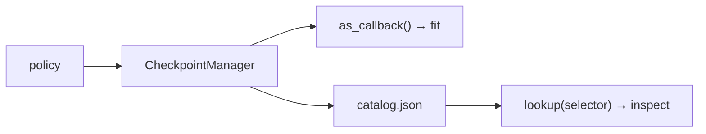

# CheckpointManager

`dl_toolbox_config.checkpoint_config` → Checkpoint parser → this object. Sibling of `FitConfig`, not a field inside it. Fit is not rewritten to make inspect easier.

## 1. Input

| | |
|---|---|
| Expected | `checkpoint_config`: `{ "save_top_k": int, "save_last": bool }`. Directory: `run_dir/checkpoints`. Monitor (key + mode) from [`build_experiment`](../signature/build_experiment.md) — not from this dict, not from a `monitor_config` key. |
| Comes from | Policy: [`dl_toolbox_config.checkpoint_config`](../recipe/dl_toolbox_config.md). Directory: [run identity](../recipe/run_identity.md). Monitor bound by [AbstractRunManager](../project/abstract_run_manager.md) after `build_experiment`. |
| Conditions | Exact keys `save_top_k`, `save_last`. No `dirpath`. No filename template. Filename pattern is manager opinion: `epoch=012.ckpt`. |

**Potential issues**

- Inspect assuming every epoch is on disk, or that `last` exists.
- Fit flipping `save_last` / `save_top_k=-1` because inspect asked.
- Two monitors: one on fit, a different one on this manager. Bind once from `experiment.monitor`.
- Putting `dirpath` in `checkpoint_config`.

## 2. Processing

Three layers on one object:

| Layer | What |
|---|---|
| Policy | What will be retained. |
| Callback | Subclass of Lightning `ModelCheckpoint`. Epoch-stable names. Writes catalog after each save. |
| Catalog | What actually exists after prune: epoch, rank, path, monitor value. |

Incompatibility is a **check**, not a fit change:

| Inspect asks | If policy cannot satisfy | Failure |
|---|---|---|
| `last` | `save_last=false` and last epoch not in top-k | construction or lookup |
| `epoch=5` | pruned | lookup |
| every epoch | `save_top_k != -1` | construction |

## 3. Output

| | |
|---|---|
| Expected | `as_callback()` for fit. `lookup(selector)` for inspect. `catalog.json` on disk. |
| Consumers | [fit](../loops/fit.md) registers the callback. [inspect](../loops/inspect.md) looks up one file. Fit does not interpret `save_top_k` itself. |
