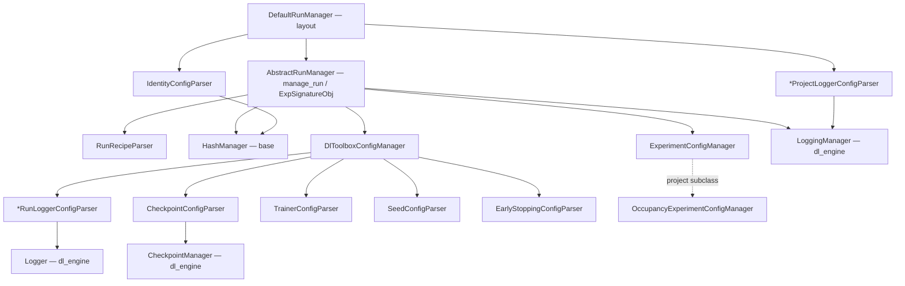
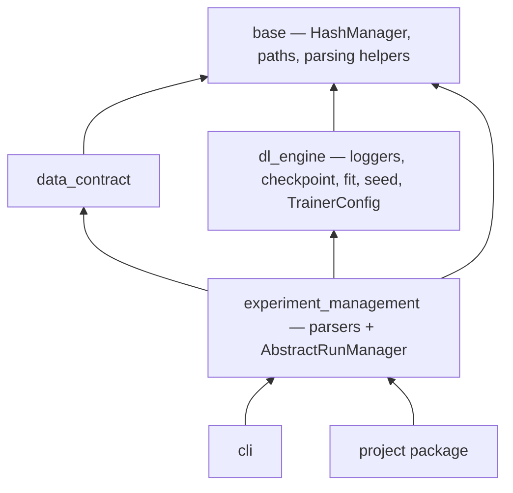
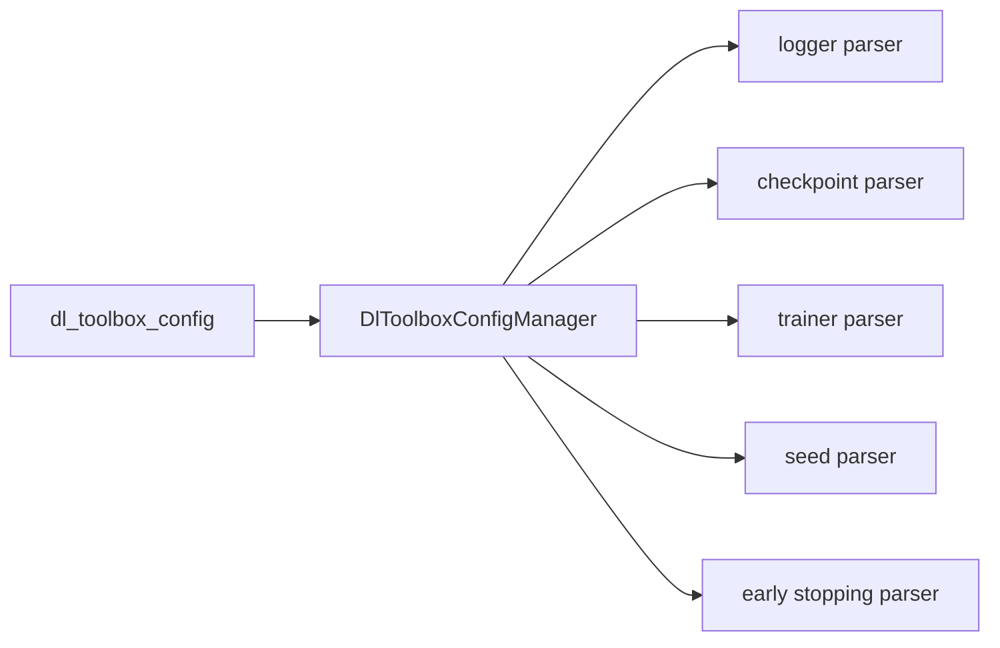
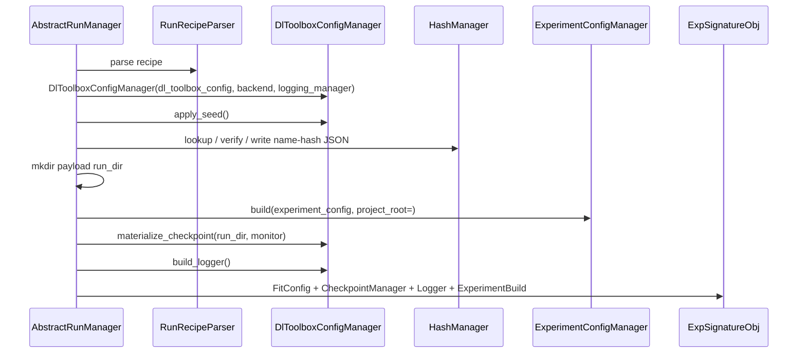

# Implementation blueprint

How the [contract](overview.md) becomes Python. Not the contract itself.

A **parser class** reads a JSON object. A **manager class** exists only when that object is **not** used as-is: it opens a store, claims a folder, builds a net, writes a catalog. Do not add a manager that only holds the parser’s fields.

**Layering.** `base` and `dl_engine` define the Python objects (`HashManager`, `LoggingManager`, `Logger`, `CheckpointManager`, `TrainerConfig`, `FitConfig`, `seed_everything`). They do not read recipe JSON, `identity.json`, or `logging/{backend}.json`. They do not know `project_root`.

`experiment_management` is the opinionated framework: parsers (`JSON → fields`) and the orchestrator that constructs those objects. `AbstractRunManager.manage_run` is what returns [`ExpSignatureObj`](signature/exp_signature_obj.md). `DefaultRunManager` is layout only (tree, which files, relative paths).

A manager in `dl_engine` / `base` must not construct a parser in `__init__`. That is the current leak: `MlflowManager` calls `MlflowParser`, and `DefaultRunManager._materialize_*` parses the same store JSON again.

The project author subclasses **one** class: `ExperimentConfigManager`.

`base.parsing` helpers stay functions. They are primitives.

## 1. Shape



`AbstractRunManager` owns the order and assembles `ExpSignatureObj`. `DefaultRunManager` does not. The user does **not** subclass `DefaultRunManager` to teach it a loss. They pass an `ExperimentConfigManager`.

```python
manager = DefaultRunManager(
    project_name="filament",
    start=Path(__file__),
    experiment_config_manager=OccupancyExperimentConfigManager(),
)
signature = manager.manage_run(recipe)
run_experiment(signature)
```

`manage_run` is inherited from `AbstractRunManager`.

## 2. Import direction



`dl_engine` never imports `experiment_management`. Loggers live **under** `dl_engine`. Checkpoint lives under `dl_engine`. Parsers live **only** in `experiment_management`.

## 3. When a manager exists

Logging already has three layers because the **store** is not the **run**: parser (schema, no vendor) → manager (sqlite / parent `log_dir`, vendor SDK) → logger (this run). That complexity is already built. Do not add a fourth class in front of it.

| JSON / object | Parser | Manager? | Why |
|---|---|---|---|
| `trainer_config` | `TrainerConfigParser` | no | fields go onto `FitConfig.trainer` |
| `seed_config` | `SeedConfigParser` | no | integer goes to `seed_everything` |
| `early_stopping_config` | `EarlyStoppingConfigParser` | no | object goes onto `FitConfig.early_stopping` |
| `project_level_configs/logging/{backend}.json` | `{Backend}ProjectLoggerConfigParser` | **yes** — `LoggingManager` in `dl_engine` | store. Relative paths resolved here. Manager does not parse. |
| `logger_config` | `{Backend}RunLoggerConfigParser` | no | fields go into the `Logger` constructor, with the `LoggingManager` |
| `checkpoint_config` | `CheckpointConfigParser` | **yes** — `CheckpointManager` | policy is not the callback, not the catalog, not inspect lookup. `dirpath` and monitor are bound later. Fit and inspect both consume the manager. |
| recipe file | `RunRecipeParser` | no | three fields |
| `project_level_configs/identity.json` | `IdentityConfigParser` | **yes** — `HashManager` in `base` | prefix length + folder names. Parser in experiment_management. HashManager does not parse. |
| run claim / open | — | `HashManager` + payload mkdir | records JSON pair vs run artifact folder |
| `dl_toolbox_config` | — | `DlToolboxConfigManager` | dispatches parsers, exact keys, order |
| `experiment_config` | project parser | `ExperimentConfigManager` | builds net, loaders, metrics, monitor |

`DlToolboxConfigManager` is the composer. Dispatch (which logger parser, when to seed, when to construct `CheckpointManager`) lives there. That is not a `TrainerConfigManager`.

## 4. Package tree

Housekeeping first: delete the three top-level modules. Fold `project_layout/` into `experiment_management/project/`.

```
src/dl_toolbox/
  base/file_management/paths.py          # was dl_toolbox.paths
  base/hashing/
    identity.py                          # digest primitives used by HashManager
    hash_manager.py                      # HashManager — no parser
  dl_engine/
    seed.py                              # was dl_toolbox.dl_engine.seed — seed_everything only
    loggers/                             # was dl_toolbox.dl_engine.loggers — managers + loggers, no parsers
      base_logger.py
      factory.py                         # name → Logger class, no JSON
      mlflow/{mlflow_manager.py, mlflow_logger.py}
      wandb/...
      tensorboard/...
      placeholder/...
    training/
      config.py                          # TrainerConfig, MonitorConfig, EarlyStoppingConfig, FitConfig
      checkpoint.py                      # CheckpointManager
      fit.py
      module.py
  experiment_management/
    recipe/
      run_recipe.py                      # RunRecipeParser, RunRecipe
      run_identity.py                    # RunIdentity value object
    project/
      abstract_run_manager.py            # AbstractRunManager — manage_run / open_run
      default_run_manager.py             # DefaultRunManager — layout
      identity_parser.py                 # IdentityConfigParser
      layout.py
      discover.py
      scaffold.py
    logging/
      project_parser.py                  # {Backend}ProjectLoggerConfigParser
      run_parser.py                      # {Backend}RunLoggerConfigParser
    toolbox/
      manager.py                         # DlToolboxConfigManager
      checkpoint/parser.py               # CheckpointConfigParser only
      trainer/parser.py
      seed/parser.py
      early_stopping/parser.py
    experiment/
      manager.py                         # ExperimentConfigManager ABC
      build.py                           # ExperimentBuild
    signature/
      exp_signature_obj.py
    loops/
      run_experiment.py
      inspect.py                         # last
```

Tests mirror this tree. A parser test imports **only** that parser.

## 5. Parser classes (pass-through configs)

Every parser: `__init__(self, payload: dict)`, `require_exact_keys`, `base.parsing` helpers, no defaults for forgotten keys, no sibling configs, no disk, no Lightning.

### 5.1 Trainer — `toolbox/trainer/parser.py`

`TrainerConfigParser`. Exact keys: `max_epochs`, `accelerator`, `devices`, `precision`, `enable_progress_bar`.

Produces `TrainerConfig` (add `precision` on the dataclass). `DlToolboxConfigManager` puts it on `FitConfig.trainer`.

### 5.2 Seed — `toolbox/seed/parser.py`

`SeedConfigParser`. Exact keys: `{ "seed": int }`, `seed >= 0`.

`DlToolboxConfigManager.apply_seed()` calls `dl_toolbox.dl_engine.seed.seed_everything(parser.seed)` with **this** integer. Never the helper’s default `69`. Call that **before** `ExperimentConfigManager.build`. No `SeedConfigManager`.

### 5.3 Early stopping — `toolbox/early_stopping/parser.py`

`EarlyStoppingConfigParser`. Exact keys: `name`, `params`.

- class constants on `EarlyStoppingConfig`: `NONE = "none"`, `PATIENCE = "patience"`
- `NONE` → `params` exact `{}`
- `PATIENCE` → `params` exact `{ "patience": int >= 1, "min_delta": number >= 0 }`

Produces `EarlyStoppingConfig`. Always an object. Off is `name=NONE`. Goes onto `FitConfig.early_stopping`. Fit registers Lightning `EarlyStopping` only for `PATIENCE`. No toolbox early-stopping manager.

### 5.4 Logging — `logging/project_parser.py` and `logging/run_parser.py`

Two layers, two name suffixes. Schemas differ by backend, so four pairs, not two classes.

| Backend | Project (store JSON) | Run (`logger_config`) | Run exact keys |
|---|---|---|---|
| mlflow | `MlflowProjectLoggerConfigParser` | `MlflowRunLoggerConfigParser` | `experiment`, `run_name`, `tags` |
| wandb | `WandbProjectLoggerConfigParser` | `WandbRunLoggerConfigParser` | `project`, `run_name`, `tags` |
| tensorboard | `TensorBoardProjectLoggerConfigParser` | `TensorBoardRunLoggerConfigParser` | `run_name` |
| placeholder | `PlaceholderProjectLoggerConfigParser` | `PlaceholderRunLoggerConfigParser` | `run_name` |

These **replace** `loggers/{backend}/*_parser.py` and `DefaultRunManager._materialize_*`. The project parser owns the store schema **and** `resolve_under_project`. The engine manager takes typed absolute fields (`log_dir=`, `db_path=`, …). No JSON payload in `LoggingManager.__init__`.

Project parsers do not read `run_name`. Run parsers do not read store paths.

`DefaultRunManager.make_logging_manager()` reads the file, constructs the project parser, constructs the `dl_engine` manager from its fields. `DlToolboxConfigManager.build_logger()` uses the run parser + that manager:

```python
TensorBoardLogger(manager=logging_manager, run_name=parsed.run_name)
MlflowLogger(manager=..., experiment=..., run_name=..., tags=...)
```

No `LoggerConfigManager`. Parsers expose fields; they do not construct the manager or logger (parser tests stay vendor-free).

Logger constructor change:

- `TensorBoardLogger` and `PlaceholderLogger` take `run_name`
- child folder is `logging_manager.log_dir / run_name`
- tests that call `get_logger` without `run_name` pass `run_name="test"`

## 6. Checkpoint — parser + manager

**File** `toolbox/checkpoint/parser.py` — `CheckpointConfigParser`

Exact keys: `save_top_k`, `save_last`. No `dirpath`. No filename. No monitor. Holds the policy. That is all the parser does.

**File** `dl_engine/training/checkpoint.py` — `CheckpointManager`

This is the manager. Policy is not used as-is:

- directory is `run_dir / "checkpoints"` (from identity, after claim)
- monitor is bound from `ExperimentBuild` (after the experiment manager)
- `as_callback()` is what fit registers
- `catalog.json` is what inspect reads
- `lookup(selector)` fails closed
- filename opinion: `epoch=012.ckpt`

No `CheckpointConfigManager` in `experiment_management`. That would be a holder for two ints. `DlToolboxConfigManager` constructs `CheckpointManager` once `run_dir` and `monitor` exist:

```python
CheckpointManager(
    save_top_k=parser.save_top_k,
    save_last=parser.save_last,
    run_dir=run_dir,
    monitor=monitor,
)
```

## 7. `DlToolboxConfigManager`

**File** `toolbox/manager.py`

Exact keys of `dl_toolbox_config`:

```
logger_config, checkpoint_config, trainer_config, seed_config, early_stopping_config
```

Unknown key refuses. Missing key refuses. No `monitor_config`.

It constructs the **parsers** (and later `CheckpointManager` / `Logger`). It does not read nested keys itself.



Methods `AbstractRunManager` calls:

| Method | When | Result |
|---|---|---|
| `apply_seed()` | after construct, before experiment build | `seed_everything(seed)` |
| `build_logger()` | after construct | existing `Logger` |
| `trainer_config()` | assemble `FitConfig` | `TrainerConfig` |
| `early_stopping_config()` | assemble `FitConfig` | `EarlyStoppingConfig` |
| `materialize_checkpoint(run_dir=..., monitor=...)` | after claim **and** experiment build | `CheckpointManager` |
| `seed_config()` | store on signature | `SeedConfig` / the parsed int object |

Not subclassed.

## 8. `ExperimentConfigManager`

**File** `experiment/manager.py`

Replaces `build_experiment` as a method on a run manager. The project subclasses this class, not `DefaultRunManager`.

```python
class ExperimentConfigManager(ABC):
    @abstractmethod
    def build(
        self,
        experiment_config: Mapping[str, Any],
        *,
        project_root: Path,
    ) -> ExperimentBuild:
        raise NotImplementedError
```

The project writes the subclass. Task JSON parser (`OccupancyTrainConfigParser`) lives in the **project**.

**File** `experiment/build.py` — `ExperimentBuild`

Usual class. Keyword-only `__init__`. Every field required. No `None`.

| Field | Role |
|---|---|
| `model` | `nn.Module` |
| `train_loader`, `val_loader` | data |
| `optimizer` | bound to the model |
| `loss_fn` | backward |
| `prepare_tensors_fn` | raw batch → tensors |
| `forward_fn` | net + batch → output |
| `build_metric_inputs_fn` | output + batch → metric tensors |
| `train_metrics`, `val_metrics` | `MetricSpec` lists |
| `monitor` | `MonitorConfig` (`key`, `mode`) |

`monitor.key` is already `metric_log_name(...)`. The project parser checks it against `val_metrics`.

## 9. `HashManager` (project identity)

Contract: [`project/hash_manager.md`](project/hash_manager.md).

This is the class `identity.py` already asks for: one project, one prefix length, callers never pass `prefix_len`. Data-contract process records and run experiments use the **same** exclusive pair. Do not copy `assert_generating_process_name_available` into experiment management.

**File** `project_level_configs/identity.json` — not in the recipe, not in the run hash. Not a records path: folder **names** are project-wide; which tree is indexed is the `directory` argument.

```json
{
  "prefix_len": 12,
  "human_readable_dirname": "human_readable",
  "hashes_dirname": "hashes"
}
```

Exact keys. `prefix_len` in `[8, 64]`. Folder names are distinct basenames (no `/`, not `.` / `..`, not a hash stem). `setup-project` writes this file. Treat it as frozen after the first write.

**File** `base/hashing/hash_manager.py` — `HashManager`

**File** `experiment_management/project/identity_parser.py` — `IdentityConfigParser`

`IdentityConfigParser` validates. `HashManager(prefix_len=, human_readable_dirname=, hashes_dirname=)` does not read disk. `DefaultRunManager.make_hash_manager()` reads the JSON, constructs the parser, then `HashManager`. Same lifetime as `LoggingManager`. Name the class `HashManager`, not `Hash`. `hash` is the digest.

```python
class HashManager:
    def hash_payload(self, payload: object) -> str: ...
    def stem(self, configuration_hash: str) -> str: ...
    def is_hash_stem(self, name: str) -> bool: ...
    def assert_name(self, name: str) -> str: ...

    def lookup_name_hash_json(
        self, directory: Path, *, name: str, configuration_hash: str
    ) -> ...:  # both_free | both_match | name_taken | hash_taken

    def verify_name_hash_json_unique(
        self, directory: Path, *, name: str, configuration_hash: str
    ) -> None:
        # both_free or raise

    def write_name_hash_json_unique(
        self,
        directory: Path,
        *,
        name: str,
        configuration_hash: str,
        extra: Mapping[str, Any] | None = None,
    ) -> tuple[Path, Path]:
        # verify, then write both files:
        # { "name": name, "hash": configuration_hash, **extra }
        # extra must not repeat name or hash (process signature lives here).
```

Paths it owns, under the **records** `directory` the caller passes:

```
{directory}/{human_readable_dirname}/{name}.json
{directory}/{hashes_dirname}/{stem}.json
```

Both files are the same document. Filenames use the prefix; the document stores the full SHA-256. `verify` / `write` inject the configured folder names. Callers never hard-code `"human_readable"` or `"hashes"`.

`lookup` is required. `verify_unique` is only the write path. Inspect needs **both exist and agree** — that is not uniqueness.

**Not this class:** payload directories. Process `artifacts_dir(name)` and run checkpoint folders stay the caller’s, same as `payload_dir` on process records.

**Later, not this pass:** `data_contract.process_records` should call `HashManager` instead of `prefix_len=` on every function. Collection configs that mix alias + hash in **one** folder (`save_hashed_artifact`) are a different layout; do not force them through `human_readable/` + `hashes/` until that helper is rewritten.

## 10. Recipe and run identity

**File** `recipe/run_recipe.py`

- `RunRecipeParser(payload)` — exact keys `human_readable_name`, `dl_toolbox_config`, `experiment_config`
- `human_readable_name` via `HashManager.assert_name`
- the two configs are dicts; **not** parsed here
- `RunRecipe` holds the three fields
- configuration hash = `hash_manager.hash_payload({"dl_toolbox_config": ..., "experiment_config": ...})`

**File** `recipe/run_identity.py` — `RunIdentity` value object (`run_dir`, `human_readable_name`, `hash`). No `RunIdentityManager`.

Records directory: `storage/runs`. Payload directory: `storage/run_artifacts/{name}` (checkpoints live here). Do not put payload folders next to `human_readable/` and `hashes/` as `storage/runs/{name}/` — that collides with the index tree.

| name vs hash | claim (fit) | open (inspect) |
|---|---|---|
| both free | `verify` + `write` the JSON pair, mkdir payload | refuse |
| both exist and agree | refuse (already claimed) | payload must exist; return `RunIdentity` |
| name taken, other hash | refuse | refuse |
| hash taken, other name | refuse | refuse |

`AbstractRunManager` calls `HashManager` then creates the payload dir (path from `DefaultRunManager`). Claim vs open stay two methods on `AbstractRunManager`.

## 11. `AbstractRunManager.manage_run`

**File** `project/abstract_run_manager.py` — `manage_run` / `open_run`.

**File** `project/default_run_manager.py` — layout: marker walk, `make_logging_manager`, `make_hash_manager`, records vs payload dirs. No nested store schema. No `ExpSignatureObj` assembly.

```python
class AbstractRunManager(ABC):
    def __init__(self, *, experiment_config_manager: ExperimentConfigManager): ...
    def manage_run(self, recipe) -> ExpSignatureObj: ...
    def open_run(self, recipe) -> ExpSignatureObj: ...

class DefaultRunManager(AbstractRunManager):
    def __init__(
        self,
        project_name: str,
        *,
        start: Path,
        experiment_config_manager: ExperimentConfigManager,
    ): ...
```



Assemble:

- `FitConfig(trainer, monitor, early_stopping)` — not logger, not checkpoint
- `ExpSignatureObj`: identity, `fit_config`, `checkpoint_manager`, `logger`, `seed`, `experiment`

`manage_run` claims. Inspect calls `open_run`. Two methods. No boolean default.

## 12. `ExpSignatureObj` and loops

**File** `signature/exp_signature_obj.py` — usual class, keyword-only, all slots required.

**File** `loops/run_experiment.py` — one function. Entry point, not a parser.

```python
def run_experiment(signature: ExpSignatureObj):
    e = signature.experiment
    return fit_classification(
        e.model, e.train_loader, e.val_loader, e.optimizer,
        prepare_tensors_fn=e.prepare_tensors_fn,
        forward_fn=e.forward_fn,
        loss_fn=e.loss_fn,
        build_metric_inputs_fn=e.build_metric_inputs_fn,
        train_metrics=e.train_metrics,
        val_metrics=e.val_metrics,
        config=signature.fit_config,
        checkpoint_manager=signature.checkpoint_manager,
        logger=signature.logger,
    )
```

**File** `dl_engine/training/fit.py` — `fit_classification(..., config, *, checkpoint_manager, logger)`. Registers `checkpoint_manager.as_callback()`. Early stopping callback only if `name == PATIENCE`. `L.Trainer(..., logger=False)`. No `FitConfig.checkpoint`. No `FitConfig.logger`.

**File** `loops/inspect.py` — last. `open_run`, `checkpoint_manager.lookup`, exclusive `inspection_runs/epoch=N`.

## 13. `dl_engine` value objects

| Class | Fields |
|---|---|
| `TrainerConfig` | `max_epochs`, `accelerator`, `devices`, `precision`, `enable_progress_bar` |
| `MonitorConfig` | `key`, `mode` |
| `EarlyStoppingConfig` | `NONE` / `PATIENCE`; `name`; patience fields only for `PATIENCE` (`EarlyStoppingConfig.none()` vs parsed patience) |
| `FitConfig` | `trainer`, `monitor`, `early_stopping` |
| `SeedConfig` | `seed` — whatever the seed parser exposes; signature stores it |

Delete `CheckpointConfig` and `LoggerConfig` from `FitConfig`.

## 14. What the project writes

```python
class OccupancyExperimentConfigManager(ExperimentConfigManager):
    def build(self, experiment_config, *, project_root: Path) -> ExperimentBuild:
        parsed = OccupancyTrainConfigParser(experiment_config)
        ...
        return ExperimentBuild(..., monitor=MonitorConfig(key=..., mode=...))
```

```python
signature = DefaultRunManager(
    project_name="filament",
    start=Path(__file__),
    experiment_config_manager=OccupancyExperimentConfigManager(),
).manage_run(recipe_path)
run_experiment(signature)
```

No `class FilamentRunManager(DefaultRunManager)`.

## 15. Build order

1. **Housekeeping.** Move layout / `RunManager` → `AbstractRunManager` / `seed` / `paths`. Move `loggers/` under `dl_engine`. Strip parsers out of logger packages. No new behavior yet.
2. **`HashManager` (base) + `IdentityConfigParser` (experiment_management).** Tests: unique pair, name taken, hash taken, both match. No Lightning.
3. **Project/run logger parsers** in experiment_management. `LoggingManager.__init__` takes typed fields. Delete `DefaultRunManager._materialize_*`.
4. **Other parsers in isolation.** Recipe, trainer, seed, early stopping, checkpoint policy.
5. **`DlToolboxConfigManager`.** Exact keys. `monitor_config` refuses. `apply_seed` / `build_logger` still do not need `run_dir`.
6. **`CheckpointManager` in `dl_engine`.** Policy + `run_dir` + monitor. Catalog + lookup tests without `manage_run`.
7. **`ExperimentBuild` + ABC.** Tiny in-repo subclass under tests.
8. **`AbstractRunManager.manage_run`.** Seed → HashManager claim → experiment build → bind monitor → signature. Do not call fit yet.
9. **Slim fit + `run_experiment`.**
10. **Inspect.**

## 16. Class index

| Class | File | Role |
|---|---|---|
| `HashManager` | `base/hashing/hash_manager.py` | manager: digest, stems, exclusive name/hash JSON pair |
| `IdentityConfigParser` | `project/identity_parser.py` | parser for `identity.json` |
| `{Backend}ProjectLoggerConfigParser` | `logging/project_parser.py` | parser for store JSON → typed fields |
| `{Backend}RunLoggerConfigParser` | `logging/run_parser.py` | parser for `logger_config` → Logger kwargs |
| `LoggingManager` / `Logger` | `dl_engine/loggers/...` | store / run — no parsers |
| `RunRecipeParser` / `RunRecipe` | `recipe/run_recipe.py` | parser |
| `RunIdentity` | `recipe/run_identity.py` | value object |
| `AbstractRunManager` | `project/abstract_run_manager.py` | ABC; `manage_run` / `open_run` → `ExpSignatureObj` |
| `DefaultRunManager` | `project/default_run_manager.py` | layout |
| `DlToolboxConfigManager` | `toolbox/manager.py` | composer of toolbox parsers |
| `CheckpointConfigParser` | `toolbox/checkpoint/parser.py` | parser (policy only) |
| `CheckpointManager` | `dl_engine/training/checkpoint.py` | manager |
| `TrainerConfigParser` | `toolbox/trainer/parser.py` | parser |
| `SeedConfigParser` | `toolbox/seed/parser.py` | parser |
| `EarlyStoppingConfigParser` | `toolbox/early_stopping/parser.py` | parser |
| `ExperimentConfigManager` | `experiment/manager.py` | manager (ABC; project subclass) |
| `ExperimentBuild` | `experiment/build.py` | return object |
| `ExpSignatureObj` | `signature/exp_signature_obj.py` | shared handle |
| `FitConfig` | `dl_engine/training/config.py` | trainer + monitor + early stopping |

Functions that stay functions: `base.parsing.*`, `seed_everything`, `run_experiment`, `fit_classification`, `setup_project`, `find_project_root`. Digests go through `HashManager.hash_payload`, not a leftover free `hash_payload` at call sites.
