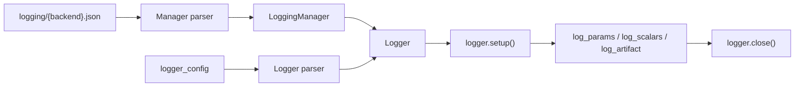

# Logger

One training run. Training code never imports a vendor SDK.

Two payloads, two lifetimes:

| | LoggingManager | Logger |
|---|---|---|
| Lifetime | project | this run |
| File | `project_level_configs/logging/{backend}.json` | `dl_toolbox_config.logger_config` |
| Parser | backend Manager parser | backend Logger parser |
| Holds | store (sqlite, artifact root, parent `log_dir`, W&B `dir`) | vendor run identity (`experiment` / `project`, `run_name`, tags) |

`.tracking-backend` selects **which pair of parsers** run. It is not a recipe field.

## 1. Input

| | |
|---|---|
| Expected | The [LoggingManager](logging_manager.md) already built. `logger_config` matching the selected backend’s Logger parser (exact keys). |
| Comes from | Manager: [project files](../project/project_files.md). `logger_config`: [`dl_toolbox_config`](../recipe/dl_toolbox_config.md). |
| Conditions | Fit opens a **live** run. Inspect must not call `start_run(run_id)` while fit might still be open. |

**MLflow `logger_config`**

```json
{ "experiment": "pretrain_mim", "run_name": "local_swin_tiny", "tags": { "task": "mim" } }
```

**W&B `logger_config`**

```json
{ "project": "pretrain_mim", "run_name": "local_swin_tiny", "tags": { "task": "mim" } }
```

**TensorBoard / placeholder `logger_config`**

```json
{ "run_name": "local_swin_tiny" }
```

`run_name` here is the vendor run / child folder. It is not [`human_readable_name`](../recipe/run_identity.md). They may be the same string. They are not aliased.

**Potential issues**

- Setting MLflow `experiment` or W&B `project` to `RunManager.project_name` by default. One toolbox project, several tracking experiments, is a normal use. The recipe must name the experiment.
- Putting `experiment` / `project` / `run_name` / `tags` in the LoggingManager JSON.
- TensorBoard Logger writing on the parent `log_dir` instead of `log_dir / run_name`.
- Inspect using fluent `start_run(run_id=)` on MLflow.
- Re-logging fit params from inspect (MLflow params are immutable).

## 2. Processing



The Logger parser is backend-specific, same as the Manager parser. Extra keys refuse. Switching `.tracking-backend` without matching `logger_config` keys fails at parse.

## 3. Output

| | |
|---|---|
| Expected | Vendor run opened with **this** `experiment`/`project` and `run_name`. Scalars, params, artifacts. Optional `run_id` (MLflow). |
| Consumers | [fit](../loops/fit.md) (live). [inspect](../loops/inspect.md) (same vendor run, `artifact_path=inspection/epoch=N`). [ExpSignatureObj](../signature/exp_signature_obj.md). |
