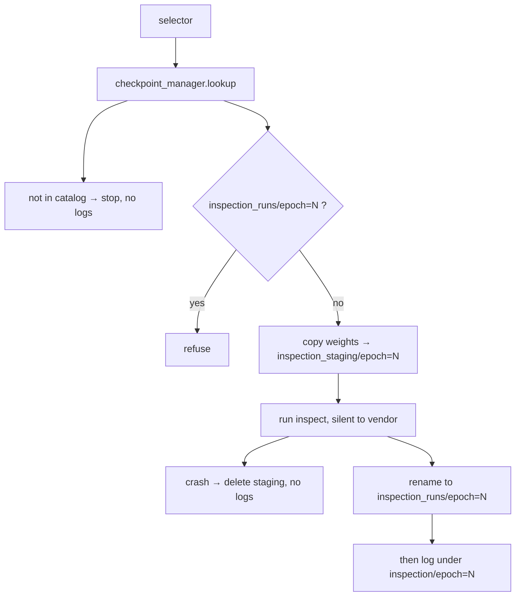

# Inspect

One invocation, one epoch, one folder. Same [`ExpSignatureObj`](../signature/exp_signature_obj.md) as fit. Different writer rules.

## 1. Input

| | |
|---|---|
| Expected | The same run recipe (so `open_run`, not claim). A selector: `epoch=N`, `rank=1`, or `last`. Not a recipe field. |
| Comes from | Train script’s sibling inspect script. Selector from CLI. Signature from `open_run` (HashManager **both_match**, seed applied, then `build_experiment`). Weights from [`CheckpointManager.lookup`](../checkpoint/checkpoint_manager.md). Net from [`build_experiment`](../signature/build_experiment.md). |
| Conditions | [`HashManager.lookup`](../project/hash_manager.md) is both-exist-and-agree for this name and configuration hash. Payload dir already exists. Selector must resolve in the catalog. `inspection_runs/epoch=N` must not already exist. |

**Potential issues**

- Assuming all epochs are saved, or that `last.ckpt` exists. Lookup fails closed. Fit is not changed.
- Two live MLflow writers (`start_run(run_id)` while fit is open).
- Second inspect of the same epoch (timestamped folders). Folder name is `epoch=N`, exclusive.
- Logging inspect artifacts before commit. Crash would publish a partial run.

## 2. Processing

MLflow: same training `run_id`, subdirectory `inspection/epoch=N`. Client API, not `start_run`.

## 3. Output

| | |
|---|---|
| Expected | `inspection_runs/epoch=N/` with `manifest.json` + artifacts. Same files on the vendor run under `inspection/epoch=N`. |
| Consumers | Error analysis. Metric breakdowns that use the same names as [metrics](../../metrics/philosophy.md). Never fit. |
