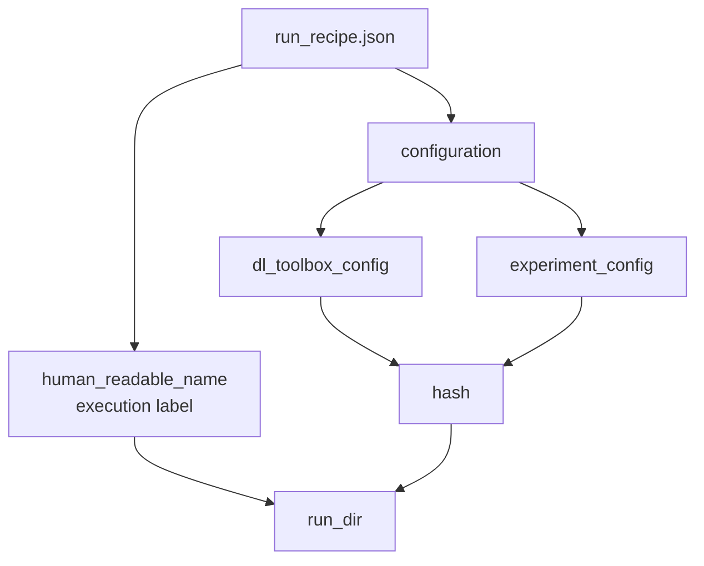
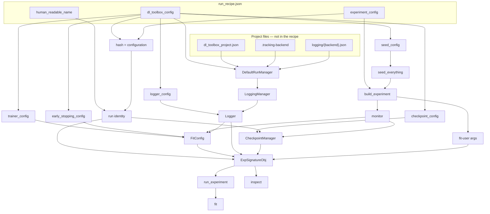
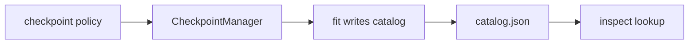

# Experiment management

Design contract. Code that more than one project should call moves into `src/dl_toolbox`. This folder is the map.

Writing a run recipe instantiates the framework: each key has one reader. A field with no component, or a component that reads an undeclared path, is a design hole.

Fit and inspect never share a process. They stay coherent because they consume the same [`ExpSignatureObj`](signature/exp_signature_obj.md).

## File vs configuration

The recipe **file** has three keys. The **configuration** is only the two sub-configs. The name is a label in the file. It is not configuration. It is not hashed.

## Recipe → object → loops

Monitor is not a `dl_toolbox_config` key. The experiment names the metric; `manage_run` binds it once onto checkpoint, early stopping, and `FitConfig`.

## Constraint

Inspect never writes policy. Fit never reads inspect config.

## Folders

| Folder | What to read |
|---|---|
| [recipe/](recipe/run_recipe.md) | The JSON file. Name vs configuration. [`dl_toolbox_config`](recipe/dl_toolbox_config.md) sub-configs. |
| [project/](project/project_files.md) | Layout, discovery, `DefaultRunManager.manage_run`. |
| [logging/](logging/logging_manager.md) | Store vs run logger. |
| [checkpoint/](checkpoint/checkpoint_manager.md) | Policy, callback, catalog. |
| [training/](training/trainer.md) | Trainer, seed, early stopping. |
| [signature/](signature/exp_signature_obj.md) | Shared object. `build_experiment`. |
| [loops/](loops/run_experiment.md) | Entry point, fit, inspect. |

## Keys and readers

| Key | What it is | Reader |
|---|---|---|
| `human_readable_name` | Label in the file. Not configuration. | [run identity](recipe/run_identity.md) |
| `dl_toolbox_config` | Named sub-configs (hashed). | [dl_toolbox_config](recipe/dl_toolbox_config.md) → parsers |
| `dl_toolbox_config.logger_config` | Run-level Logger fields. | [Logger](logging/logger.md) |
| `dl_toolbox_config.checkpoint_config` | Retention policy. | [CheckpointManager](checkpoint/checkpoint_manager.md) |
| `dl_toolbox_config.trainer_config` | Lightning loop knobs. | [Trainer](training/trainer.md) |
| `dl_toolbox_config.seed_config` | RNG seed. Applied before `build_experiment`. | [Seed](training/seed.md) |
| `dl_toolbox_config.early_stopping_config` | Required. `name` is `none` or `patience`. | [Early stopping](training/early_stopping.md) |
| `experiment_config` | Configuration (hashed). Includes which metric to monitor. | [build_experiment](signature/build_experiment.md) |
| project files | Not in the recipe. | [project files](project/project_files.md) |
| *(absent)* `monitor_config` | Task metric. Not a toolbox key. | [build_experiment](signature/build_experiment.md) |
| *(absent)* backend, stores, dirpath, inspect epoch | Not a recipe key. | project files / inspect CLI |

## What is not in this contract

Metrics grain: [metrics philosophy](../metrics/philosophy.md). Data freeze ritual: [data contract](../data_contract/philosophy.md). Both are used *inside* `build_experiment`. They are not levels of a run. Scheduler is not a sub-config this pass.
