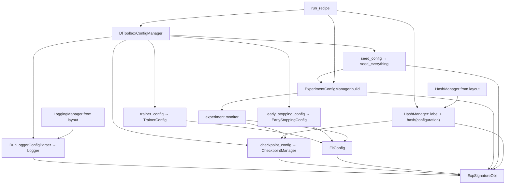

# AbstractRunManager

Owns `manage_run` / `open_run`. That is what returns [`ExpSignatureObj`](../signature/exp_signature_obj.md).

Composes [`DlToolboxConfigManager`](../implementation_blueprint.md) and [`ExperimentConfigManager`](../implementation_blueprint.md). Does not parse nested toolbox keys. Does not parse `experiment_config`. Does not treat `human_readable_name` as configuration. Does not treat `project_name` as an MLflow experiment or W&B project. Does not know the opinionated tree.

[`DefaultRunManager`](default_run_manager.md) is layout. It is not this class.

The project does **not** subclass `DefaultRunManager` to teach it a loss. It passes an `ExperimentConfigManager` into `AbstractRunManager`.

## 1. Input

| | |
|---|---|
| Expected | An `ExperimentConfigManager`. Layout hooks from the concrete class (`project_root`, `tracking_backend`, `make_logging_manager`, `make_hash_manager`, records dir, payload dir). A [run recipe](../recipe/run_recipe.md). |
| Comes from | Constructor: the project’s experiment manager. Concrete class: [project files](project_files.md). `manage_run` / `open_run`: the recipe JSON. |
| Conditions | Recipe has the three keys. `dl_toolbox_config` matches the known schema. |

**Potential issues**

- Assembling `ExpSignatureObj` on `DefaultRunManager`. The ABC defines that method.
- Instantiating a run manager without an `ExperimentConfigManager`. The task lives on that object.
- Putting store paths or backend name in `dl_toolbox_config`.
- Injecting `project_name` into Logger `experiment` / `project`.
- Hashing the whole recipe file (that would include the name).
- Fit assembling `dirpath` / logger / `FitConfig` in a script instead of going through `manage_run`.
- Seeding after `build_experiment`, or skipping `seed_config`.
- Binding monitor from a `monitor_config` key. That key does not exist. The experiment returns it.
- A `RunIdentityManager`. Claim/open call [`HashManager`](hash_manager.md), then mkdir the payload dir.

## 2. Processing

See [dl_toolbox_config](../recipe/dl_toolbox_config.md) for the key → parser → object table.

Order that must not flip: parse toolbox (`DlToolboxConfigManager`) → apply seed → HashManager claim/open + mkdir payload → `ExperimentConfigManager.build` → bind monitor → assemble `FitConfig`.

`manage_run` claims. Inspect calls `open_run`. Two methods. No boolean default.

## 3. Output

| | |
|---|---|
| Expected | [`ExpSignatureObj`](../signature/exp_signature_obj.md). |
| Consumers | [`run_experiment`](../loops/run_experiment.md). Later: inspect. Scripts do not unpack the recipe themselves. |
