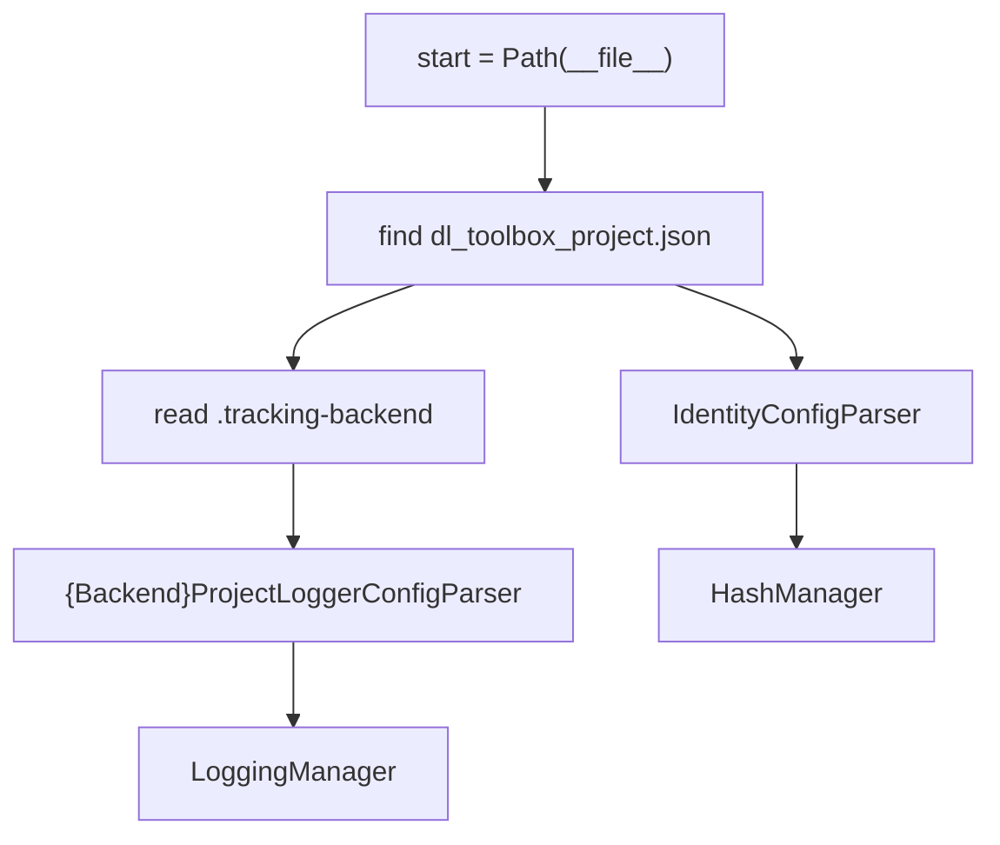

# DefaultRunManager

Opinionated project tree. Subclass of [`AbstractRunManager`](abstract_run_manager.md). Does **not** assemble [`ExpSignatureObj`](../signature/exp_signature_obj.md). `manage_run` is inherited.

Does not parse nested toolbox keys. Does not parse `experiment_config`. Does not treat `project_name` as an MLflow experiment or W&B project.

Store JSON and `identity.json` are parsed by `{Backend}ProjectLoggerConfigParser` and `IdentityConfigParser`. This class reads the files, constructs those parsers, constructs the `dl_engine` / `base` objects from their fields. It does not inline `require_exact_keys` for MLflow/TensorBoard (that duplication is `_materialize_*` today).

The project does **not** subclass this class to teach it a loss. It passes an `ExperimentConfigManager`. Class names and files: [implementation blueprint](../implementation_blueprint.md).

## 1. Input

| | |
|---|---|
| Expected | `project_name`, absolute `start`, an `ExperimentConfigManager`. |
| Comes from | Constructor: [project files](project_files.md) plus the project’s experiment manager. |
| Conditions | Marker name matches constructor. `.tracking-backend` is one of the four backends. |

**Potential issues**

- Re-implementing store schema next to `{Backend}ProjectLoggerConfigParser`.
- `LoggingManager.__init__(payload_dict)` that parses again.
- Putting payload under `storage/runs/{name}/` next to the HashManager index folders.

## 2. Processing

`make_logging_manager()` / `make_hash_manager()` are the layout hooks `AbstractRunManager` calls. Records: `storage/runs`. Payload: `storage/run_artifacts/{name}`.

## 3. Output

| | |
|---|---|
| Expected | Paths, selected `LoggingManager`, `HashManager`. Inherited `manage_run` / `open_run`. |
| Consumers | [`AbstractRunManager`](abstract_run_manager.md). Scripts instantiate this class, then call `manage_run`. |
