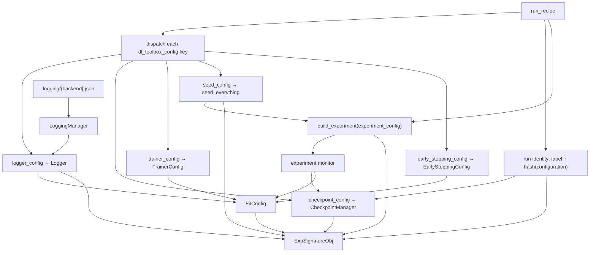

# DefaultRunManager

Opinionated layout plus `manage_run`. Dispatches each [`dl_toolbox_config`](../recipe/dl_toolbox_config.md) sub-config to its parser. Does not parse `experiment_config`. Does not treat `human_readable_name` as configuration. Does not treat `project_name` as an MLflow experiment or W&B project.

The ABC `RunManager` is smaller: `project_name`, `project_runs_dir()`, `tracking_backend()`, `make_logging_manager()`. Layout and recipe parsing stay on the default class.

A project subclass is required to run: it implements [`build_experiment`](../signature/build_experiment.md).

## 1. Input

| | |
|---|---|
| Expected | `project_name`, absolute `start`, and a [run recipe](../recipe/run_recipe.md). |
| Comes from | Constructor: [project files](project_files.md). `manage_run`: the recipe JSON. |
| Conditions | Marker name matches constructor. Recipe has the three keys. `dl_toolbox_config` matches the known schema. |

**Potential issues**

- Instantiating `DefaultRunManager` and calling `manage_run` without a subclass: `build_experiment` is abstract.
- Putting store paths or backend name in `dl_toolbox_config`.
- Injecting `project_name` into Logger `experiment` / `project`.
- Hashing the whole recipe file (that would include the name).
- Fit assembling `dirpath` / logger / `FitConfig` in a script instead of going through `manage_run`.
- Seeding after `build_experiment`, or skipping `seed_config`.
- Binding monitor from a `monitor_config` key. That key does not exist. The experiment returns it.

## 2. Processing

See [dl_toolbox_config](../recipe/dl_toolbox_config.md) for the key → parser → object table.

Order that must not flip: parse toolbox → apply seed → claim/open → `build_experiment` → bind monitor → assemble `FitConfig`.

## 3. Output

| | |
|---|---|
| Expected | [`ExpSignatureObj`](../signature/exp_signature_obj.md). |
| Consumers | [`run_experiment`](../loops/run_experiment.md). Later: inspect. Scripts do not unpack the recipe themselves. |
