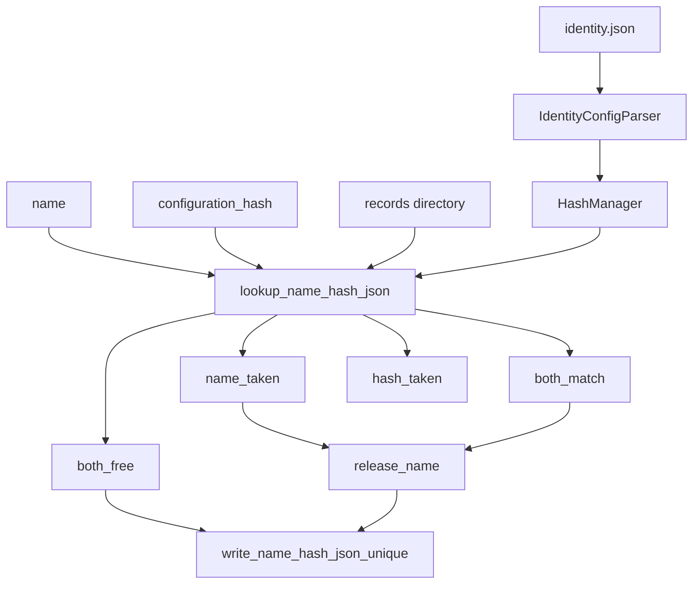

# HashManager

Project-level identity. One object per project. The exclusive (name, hash) pair is the same ritual as data-contract process records. Runs are one caller. Processes are another.

Not a run recipe concern. Changing `prefix_len` or the index folder names must not change a run hash: this file is not among the two sub-configs.

Class name is `HashManager`, not `Hash`. `hash` is the digest.

## 1. Input

| | |
|---|---|
| Expected | `project_level_configs/identity.json` with **exactly** three keys. A records `directory` at each call (process configs dir, or `storage/runs`). A basename `name`. A full SHA-256 `configuration_hash`. Optional `extra` keys on write. |
| Comes from | JSON: [project files](project_files.md), written by `setup-project`. `IdentityConfigParser` in experiment_management. `DefaultRunManager.make_hash_manager()` constructs `HashManager` from those fields — same lifetime as [`LoggingManager`](../logging/logging_manager.md). Callers pass their own records directory. |
| Conditions | `prefix_len` in `[8, 64]`. `human_readable_dirname` and `hashes_dirname` are distinct basenames, not `.` / `..`, not a hash stem. `name` is a basename, not a hash stem (`HashManager.assert_name`). Call sites never pass `prefix_len`. |

```json
{
  "prefix_len": 12,
  "human_readable_dirname": "human_readable",
  "hashes_dirname": "hashes"
}
```

**Potential issues**

- A class named `Hash`. That is the digest.
- `verify_name_hash_json_unique` as the only method. Inspect needs **both exist and agree**.
- Putting payload under the records parent (`storage/runs/{name}/` next to the two index folders). Payload is the caller’s, same as process `artifacts_dir`.
- `force=` on `write_name_hash_json_unique`. Unique write stays unique. `release_name` is the helper, same split as `process()` vs `remove_named_freeze`.
- Treating HashManager as owning `run_artifacts` or logger folders. It is the identity index only.
- Passing `prefix_len` into claim/open/process. One project, one length, on this object.
- Putting the records path in `identity.json`. Folder **names** are project-wide; which tree is indexed is per call.
- Hashing `identity.json` into the run. It is project-level, like logging JSON.
- Changing `prefix_len` after the first write. Existing stems become unreadable. Treat the file as frozen.
- Copying `assert_generating_process_name_available` into experiment management.

## 2. Processing



`IdentityConfigParser` validates. `HashManager` holds the three knobs and injects them into paths. It does not read `identity.json`.

```
{directory}/{human_readable_dirname}/{name}.json
{directory}/{hashes_dirname}/{stem}.json
```

`stem` is the first `prefix_len` characters of the full SHA-256. Both files are the same document:

```json
{ "name": "<name>", "hash": "<full sha256>", "...extra": "..." }
```

`HashManager` owns `name` and `hash`. Extra keys are the caller’s (`generating_process_signature` for a process). If `extra` repeats `name` or `hash`, refuse.

| Method | Job |
|---|---|
| `hash_payload` | Full SHA-256 of canonical JSON. |
| `stem` / `is_hash_stem` / `assert_name` | Prefix policy. No `prefix_len=` on the call. |
| `lookup_name_hash_json` | Four-way state. Reads both files; does not trust the filename. If both paths exist but belong to **two different pairs**, that is `hash_taken` (this hash) or `name_taken`, not a corrupt pair. |
| `verify_name_hash_json_unique` | `both_free` or raise. Write path only. No overwrite flag. |
| `release_name` | Delete the name JSON and the hash JSON it points at. Returns the document, or `None` if the name is free. Refuses if the two files disagree. Does not steal a hash held by another name. Does not touch payload. |
| `write_name_hash_json_unique` | `verify`, then write both files. Still unique after a release. |

`dl_engine` does not import this. Data contract and experiment management both do.

Collection configs that mix alias + hash in **one** folder (`save_hashed_artifact`) are a different layout. Do not force them through these two folders until that helper is rewritten.

## 3. Output

| | |
|---|---|
| Expected | Digest, stem, lookup state, or the written JSON pair. Never a payload directory. |
| Consumers | [run identity](../recipe/run_identity.md) (`storage/runs` + `storage/run_artifacts/{name}`). Data-contract process records (process configs dir + `artifacts_dir`). [DefaultRunManager](default_run_manager.md) constructs it. |
