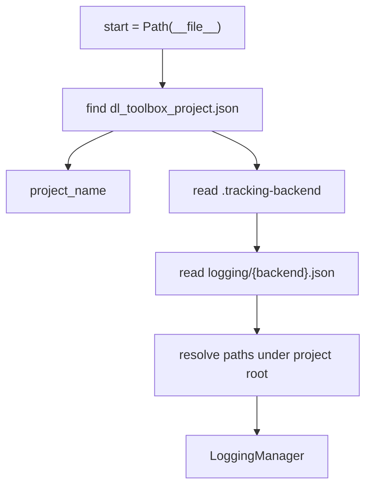

# Project files

Project-level. Not in the run recipe. Switching TensorBoard to MLflow must not change a run hash: the hash is the two sub-configs, and these files are not among them.

```
project_root/
  dl_toolbox_project.json
  .tracking-backend
  project_level_configs/logging/{backend}.json
  storage/{runs, tensorboard|mlflow|wandb|placeholder}/
  experiments/
  scripts/
```

## 1. Input

| | |
|---|---|
| Expected | Marker file, backend selector, one store JSON per backend. Paths in those JSON files are relative to the project root. |
| Comes from | `dl-toolbox setup-project`. Runtime walks from `__file__` to the marker. Never `cwd`. |
| Conditions | `dl_toolbox_project.json.name` matches `DefaultRunManager(project_name=...)`. `.tracking-backend` is one of `tensorboard`, `mlflow`, `wandb`, `placeholder`. |

**Potential issues**

- Store paths that escape the project root.
- `wandb.project` / `mlflow.experiment` / `run_name` / `tags` in logging JSON. Those are [Logger](../logging/logger.md) fields, in `logger_config`.
- Walking for a bare `storage/` folder: picks a sibling project.

## 2. Processing



Only the selected backend gets a store folder. Config files for every backend stay on disk.

## 3. Output

| | |
|---|---|
| Expected | `project_name`, `project_runs_dir`, selected `LoggingManager`. |
| Consumers | [DefaultRunManager](default_run_manager.md) holds them. [Logger](../logging/logger.md) takes the `LoggingManager` and reads vendor identity from `logger_config`. [run identity](../recipe/run_identity.md) uses `storage/runs/`. |
