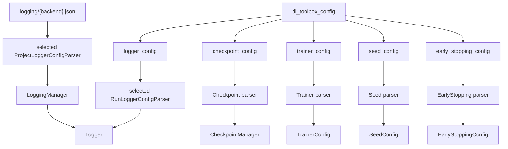

# dl_toolbox_config

Hashed half of the run configuration that the toolbox knows. An object of **named sub-configs**. Each key is read by one parser and becomes one manager (or manager-owned object). Same pattern as the logging store: `dict → parser → object`.

`DlToolboxConfigManager` dispatches. `AbstractRunManager` calls it. Neither interprets nested keys by hand.

```json
{
  "logger_config": {},
  "checkpoint_config": { "save_top_k": 3, "save_last": false },
  "trainer_config": {
    "max_epochs": 200,
    "accelerator": "gpu",
    "devices": 1,
    "precision": 32,
    "enable_progress_bar": true
  },
  "early_stopping_config": {
    "name": "patience",
    "params": { "patience": 40, "min_delta": 0.0 }
  },
  "seed_config": { "seed": 0 }
}
```

Every key in the table is required. Off for early stopping is `name: "none"`, not a missing key. `logger_config` nested keys depend on `.tracking-backend`.

## 1. Input

| | |
|---|---|
| Expected | A JSON object whose keys are sub-config names. |
| Comes from | [run recipe](run_recipe.md) (`dl_toolbox_config`). |
| Conditions | Every key has a parser. Unknown keys refuse. Missing keys refuse. Store paths, `.tracking-backend`, `dirpath` are not keys here. |

**Potential issues**

- Flat fields (`save_top_k` next to `trainer`) with no parser owner.
- `monitor_config`. The monitor names a `MetricSpec` that only [`build_experiment`](../signature/build_experiment.md) owns. A toolbox parser cannot validate it. Monitor is experiment output, bound after that function returns.
- `scheduler_config` this pass. The loop still returns a bare optimizer.
- Inferring MLflow `experiment` / W&B `project` from `AbstractRunManager.project_name`.
- Putting LoggingManager store fields here (those live in [project files](../project/project_files.md)).
- `batch_size` / `num_workers` / `lr` / `weight_decay`. Those are loaders and the optimizer, in `experiment_config`.
- Omitting `early_stopping_config` to mean off. Off is `EarlyStoppingConfig.NONE`. A missing key is a forgotten field.

## 2. Processing



| Key | Parser | Object | Required | Level of the *fields* |
|---|---|---|---|---|
| `logger_config` | `{Backend}RunLoggerConfigParser` | [Logger](../logging/logger.md) | yes | run |
| `checkpoint_config` | Checkpoint parser | [CheckpointManager](../checkpoint/checkpoint_manager.md) | yes | run |
| `trainer_config` | Trainer parser | [TrainerConfig](../training/trainer.md) | yes | run |
| `seed_config` | Seed parser | [SeedConfig](../training/seed.md) | yes | run |
| `early_stopping_config` | EarlyStopping parser | [EarlyStoppingConfig](../training/early_stopping.md) | yes | run |

The LoggingManager payload is **not** a key here. It is project-level. The Logger parser still receives that manager as a constructor argument.

`manage_run` applies `seed_config` **before** `ExperimentConfigManager.build`. It binds experiment `monitor` onto the checkpoint manager, `FitConfig`, and early stopping **after**.

## 3. Output

| | |
|---|---|
| Expected | One built object per sub-config. Seed already applied. Monitor not among them. |
| Consumers | [`manage_run`](../project/abstract_run_manager.md) stores them on [`ExpSignatureObj`](../signature/exp_signature_obj.md). Trainer and early stopping go on `FitConfig`. Logger and CheckpointManager are sibling slots. |
