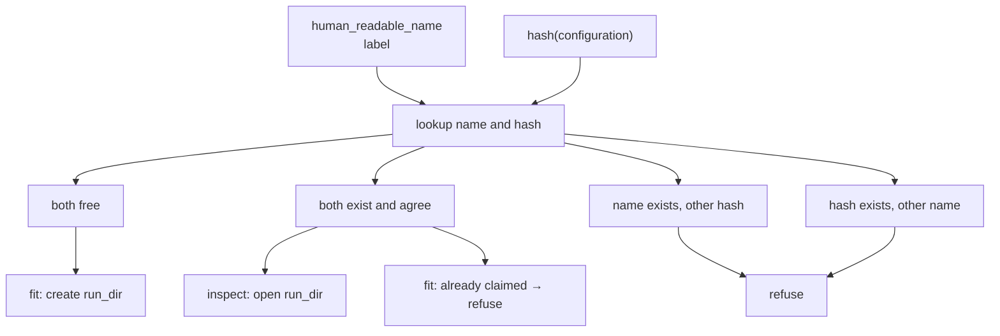

# Run identity

Binds an execution **label** to a **configuration**. The configuration is the two sub-configs. The name is not part of it.

Reads the top-level `human_readable_name`. Does not interpret trainer, loss, or data.

Same exclusive-pair idea as data-contract process records: name is one execution, hash is configuration identity.

## 1. Input

| | |
|---|---|
| Expected | `human_readable_name` (basename). Hash of the **configuration** (`dl_toolbox_config` + `experiment_config`). `project_runs_dir`. Mode: **claim** (fit) or **open** (inspect). |
| Comes from | [run recipe](run_recipe.md) (the name, sitting in the file). Hash of the two config objects only. [project files](../project/project_files.md) (`storage/runs/`). |
| Conditions | Name is not a hash stem. Hash is the full SHA-256 of the two configs. Name is not an input to the hash. |

**Potential issues**

- Hashing the name: renaming a run would look like a new configuration.
- Same name, different configuration: folder collision. Refuse.
- Same configuration, different name: two labels for one identity. Refuse.
- Fit claiming a name inspect already opened, or two fits claiming at once.

## 2. Processing

`run_dir = project_runs_dir / human_readable_name`.

## 3. Output

| | |
|---|---|
| Expected | `run_dir`, configuration `hash`, execution `human_readable_name`. Claimed or opened. |
| Consumers | [CheckpointManager](../checkpoint/checkpoint_manager.md) (`run_dir/checkpoints`). [ExpSignatureObj](../signature/exp_signature_obj.md). Inspect folders under this `run_dir`. Not the Logger: vendor `run_name` / `experiment` / `project` come from `logger_config`. |
