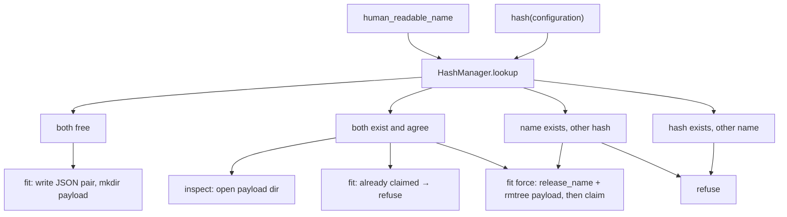

# Run identity

Binds an execution **label** to a **configuration**. The configuration is the two sub-configs. The name is not part of it.

The exclusive pair is **not** run-specific. [`HashManager`](../project/hash_manager.md) owns it (same ritual as data-contract process records). This page is how a **training run** uses that manager.

## 1. Input

| | |
|---|---|
| Expected | `human_readable_name` (basename). Hash of the **configuration** (`dl_toolbox_config` + `experiment_config`). `HashManager` from `project_level_configs/identity.json`. Records dir: `storage/runs`. Payload dir: `storage/run_artifacts/{name}`. Mode: **claim** (fit) or **open** (inspect). |
| Comes from | [run recipe](run_recipe.md) (the name). Hash via `HashManager.hash_payload` of the two config objects only. [project files](../project/project_files.md). |
| Conditions | Name is not a hash stem (`HashManager.assert_name`). Hash is the full SHA-256. Name is not an input to the hash. |

**Potential issues**

- Hashing the name: renaming a run would look like a new configuration.
- Same name, different configuration: refuse unless `manage_run(..., force=True)`.
- Same configuration, different name: refuse. Force does not steal a hash.
- Hand-deleting identity JSON while leaving `run_artifacts/{name}`. Payload is derived; `reclaim_name` / `force` removes both. HashManager does not.
- Putting payload under `storage/runs/{name}/` next to `human_readable/` and `hashes/`.
- Passing `prefix_len` into claim/open. That knob lives on `HashManager` only.
- Fit claiming a name inspect already opened, or two fits claiming at once.

## 2. Processing



Records (HashManager):

```
storage/runs/{human_readable_dirname}/{name}.json
storage/runs/{hashes_dirname}/{stem}.json
```

Payload (caller): `storage/run_artifacts/{name}/` — checkpoints, inspect folders. HashManager never creates or deletes it. `AbstractRunManager.reclaim_name` releases the pair, then `rmtree`s this directory.

Logger folders are not identity. Force does not delete TensorBoard / W&B / MLflow run directories.

A training run writes `{ "name", "hash" }` with empty extra. Process records put `generating_process_signature` in extra; `name` is the `generating_process_name`. `process()` still has no overwrite flag.

## 3. Output

| | |
|---|---|
| Expected | `RunIdentity`: payload `run_dir`, configuration `hash`, execution `human_readable_name`. |
| Consumers | [CheckpointManager](../checkpoint/checkpoint_manager.md) (`run_dir/checkpoints`). [ExpSignatureObj](../signature/exp_signature_obj.md). Inspect folders under this `run_dir`. Not the Logger. |
