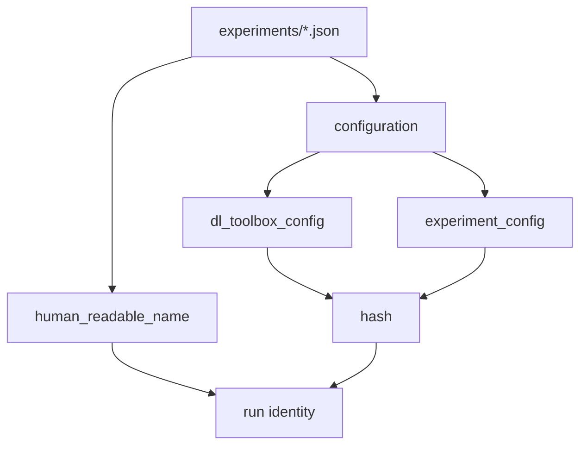

# Run recipe

One JSON file under `experiments/`. Specifying it is what wires the framework.

```json
{
  "human_readable_name": "mnist_vit",
  "dl_toolbox_config": {
    "logger_config": {},
    "checkpoint_config": { "save_top_k": 1, "save_last": false },
    "trainer_config": {
      "max_epochs": 20,
      "accelerator": "gpu",
      "devices": 1,
      "precision": 32,
      "enable_progress_bar": true
    },
    "early_stopping_config": {
      "name": "patience",
      "params": { "patience": 5, "min_delta": 0.0001 }
    },
    "seed_config": { "seed": 0 }
  },
  "experiment_config": {}
}
```

The file has three keys. The **configuration** is the two objects. The name is a label sitting next to them.

## 1. Input

| | |
|---|---|
| Expected | A JSON object with **exactly** those three keys. |
| Comes from | A file in `experiments/`. Scripts pass the path into `manage_run`. |
| Conditions | `human_readable_name` is a basename, not a hash stem. The two `*_config` values are objects. |

**Potential issues**

- Extra keys: nothing in the framework reads them → refuse.
- Missing keys: a component would have to guess → refuse.
- Treating the name as part of the configuration (hashing it, comparing runs by name).
- `logger`, backend, store paths, `checkpoint.dirpath`, inspect epoch in this file.
- `monitor_config` under `dl_toolbox_config`. The metric lives in `experiment_config`; `build_experiment` returns it.

## 2. Processing



`hash = HashManager.hash_payload({dl_toolbox_config, experiment_config})`. Prefix length is not chosen here.

## 3. Output

| | |
|---|---|
| Expected | Name (label). Two config objects (configuration). Hash of the configuration only. |
| Consumers | [`manage_run`](../project/abstract_run_manager.md), [run identity](run_identity.md), [dl_toolbox_config](dl_toolbox_config.md), [build_experiment](../signature/build_experiment.md). |
