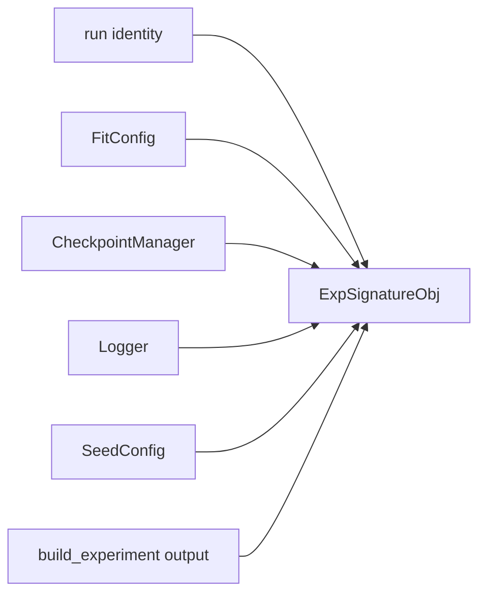

# ExpSignatureObj

The shared object. `manage_run` returns it. Fit and inspect both consume it. They do not re-read JSON.

## 1. Input

| | |
|---|---|
| Expected | Toolbox half + experiment half + run identity, already built. |
| Comes from | [DefaultRunManager.manage_run](../project/default_run_manager.md). |
| Conditions | Claim/open already succeeded. `build_experiment` already returned. Logger not necessarily `setup()` yet (fit opens it). |

**Potential issues**

- Scripts holding a recipe dict and a signature at the same time, then mixing them.
- A second object for inspect. Inspect opens the same signature for the same **configuration** (the two sub-configs), under the same name.
- Putting inspect epoch on the signature. That is a CLI selector, looked up later.

## 2. Processing

Assembly only. No training.

## 3. Output

| Slot | Who reads it |
|---|---|
| `run_dir`, `human_readable_name`, `hash` | both loops, logging dest. Name is the label. Hash is the configuration. |
| `fit_config` | [run_experiment](../loops/run_experiment.md) → [fit](../loops/fit.md). Trainer + bound monitor + early stopping + logger bundle. No checkpoint fields. |
| `checkpoint_manager` | fit (`as_callback`), inspect (`lookup`). Monitor already bound. |
| `logger` | fit live; inspect after commit |
| `seed` | Already applied in `manage_run`. Stored so callers do not re-read JSON. |
| `experiment` | fit-user args including `monitor`; inspect rebuilds the net |

| | |
|---|---|
| Consumers | [`run_experiment`](../loops/run_experiment.md). Inspect entry (not `run_experiment`). |
