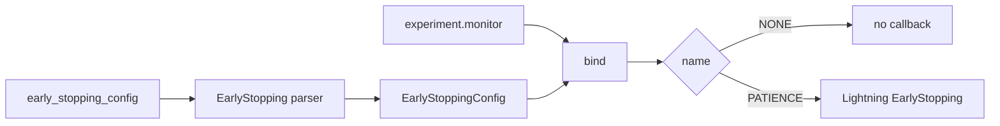

# Early stopping

`dl_toolbox_config.early_stopping_config` → EarlyStopping parser → `EarlyStoppingConfig`. Required. Loop policy. It does **not** name the metric.

Off is a **present** value: `EarlyStoppingConfig.NONE`. Same idea as `Item.ABSENT` and as `scheduler.name: "none"`. Missing key is an error. `None` is not a domain value.

## 1. Input

| | |
|---|---|
| Expected | Exact keys `name`, `params`. `name` is a class constant on `EarlyStoppingConfig`. `params` is exact for that name. |
| Comes from | [`dl_toolbox_config.early_stopping_config`](../recipe/dl_toolbox_config.md). Monitor (key + mode): [`build_experiment`](../signature/build_experiment.md), bound by [`manage_run`](../project/default_run_manager.md). |
| Conditions | `name` is `EarlyStoppingConfig.NONE` (`"none"`) or `EarlyStoppingConfig.PATIENCE` (`"patience"`). `NONE` → `params` is `{}`. `PATIENCE` → `params` is `{ "patience": int >= 1, "min_delta": float >= 0 }`. Extra or missing keys refuse. |

```json
{ "name": "none", "params": {} }
```

```json
{ "name": "patience", "params": { "patience": 40, "min_delta": 0.0 } }
```

**Potential issues**

- Omitting `early_stopping_config`. That is a forgotten key, not “off.”
- `FitConfig.early_stopping = None` or JSON `null`. Absence is `name: "none"`.
- Putting `monitor` / `mode` / a metric name in this dict. That is task vocabulary. Same leak as a `monitor_config` under `dl_toolbox_config`.
- Two monitors: one on this callback, another on the checkpoint manager. Bind once from the experiment.
- `patience: 0` as a hidden off. Off is `NONE`. On is `PATIENCE` with `patience >= 1`.

## 2. Processing

Parser always returns an object. After `build_experiment`, `manage_run` stores it on `FitConfig.early_stopping` and binds the monitor. [fit](../loops/fit.md) registers Lightning `EarlyStopping` only when `name` is `PATIENCE`.



## 3. Output

| | |
|---|---|
| Expected | `EarlyStoppingConfig`. Never `None`. |
| Consumers | [`FitConfig`](../loops/fit.md). Same monitor as [CheckpointManager](../checkpoint/checkpoint_manager.md). |
