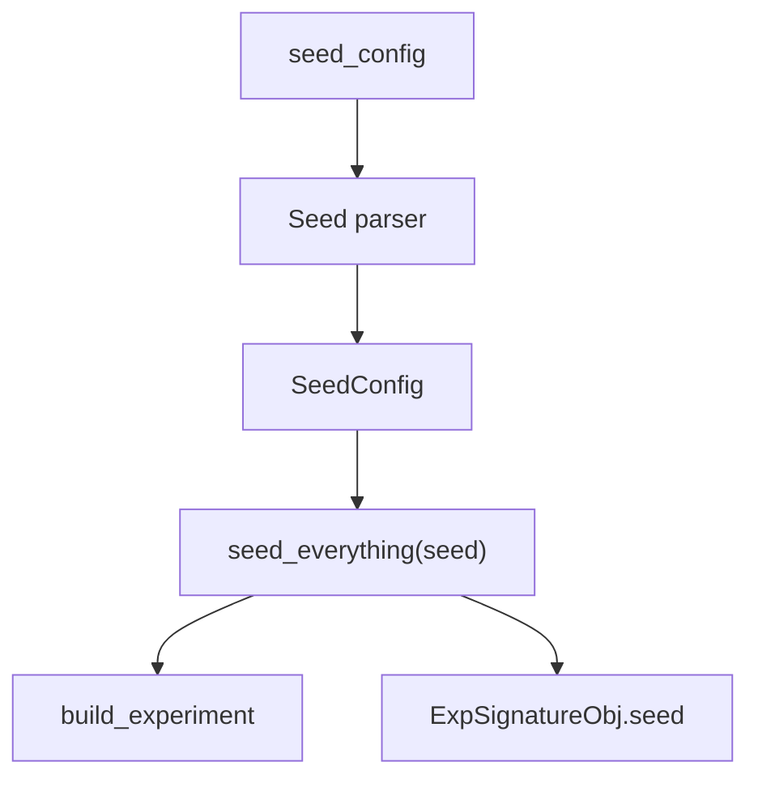

# Seed

`dl_toolbox_config.seed_config` → Seed parser → `SeedConfig`. Required. Applied **before** [`build_experiment`](../signature/build_experiment.md) so model init and loaders see it.

The helper is `dl_toolbox.seed.seed_everything`. The recipe integer is the argument. The helper’s own default is not a run default.

## 1. Input

| | |
|---|---|
| Expected | Exact key: `{ "seed": int }`. |
| Comes from | [`dl_toolbox_config.seed_config`](../recipe/dl_toolbox_config.md). |
| Conditions | `seed` is an `int`, `>= 0`. Missing `seed_config` refuses. |

```json
{ "seed": 0 }
```

**Potential issues**

- Seeding after `build_experiment`. Weights and shuffle would not be covered.
- Omitting the key and falling through to `seed_everything()`’s default `69`.
- Calling Lightning `seed_everything` instead of the toolbox helper.
- Putting `seed` under `optimization` in `experiment_config`. Then inspect and fit can drift if one path forgets it.

DataLoader `worker_init_fn` is the project’s loader job. Use this same integer there if workers must match.

## 2. Processing



`manage_run` applies it on both claim (fit) and open (inspect). Same configuration, same RNG setup before the net is built.

## 3. Output

| | |
|---|---|
| Expected | Process RNGs seeded. `SeedConfig` on the signature. |
| Consumers | [`manage_run`](../project/default_run_manager.md) (applies). [`ExpSignatureObj`](../signature/exp_signature_obj.md) (stores). Fit does not take seed as an argument. |
