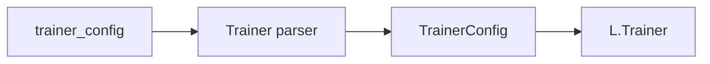

# Trainer

`dl_toolbox_config.trainer_config` → Trainer parser → `TrainerConfig`. Lightning loop knobs. Not data, not the optimizer, not the metric being monitored.

## 1. Input

| | |
|---|---|
| Expected | Exact keys: `max_epochs`, `accelerator`, `devices`, `precision`, `enable_progress_bar`. |
| Comes from | [`dl_toolbox_config.trainer_config`](../recipe/dl_toolbox_config.md). |
| Conditions | `max_epochs >= 1`. `accelerator` is a non-empty string. `devices` is `int` or `str`. `precision` is `int` or non-empty `str`. `enable_progress_bar` is `bool`. |

```json
{
  "max_epochs": 200,
  "accelerator": "gpu",
  "devices": 1,
  "precision": 32,
  "enable_progress_bar": true
}
```

**Potential issues**

- Putting `batch_size` / `num_workers` here. Those build loaders in [`build_experiment`](../signature/build_experiment.md).
- Inferring `accelerator` from CUDA availability. The recipe names it.
- Lightning `Trainer(logger=...)`. Toolbox logger stays `epoch_logger`; Trainer is `logger=False`.

## 2. Processing

Parser validates. `manage_run` stores the object on `FitConfig.trainer`. [fit](../loops/fit.md) passes the fields to `L.Trainer`.



## 3. Output

| | |
|---|---|
| Expected | `TrainerConfig`. |
| Consumers | [`FitConfig`](../loops/fit.md). Not inspect: inspect does not construct a Trainer. |
